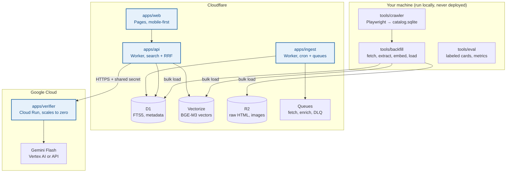

# Jachaikori — System Architecture and Local Crawler Plan

2026-11-14

## Overview

Jachaikori is four deployed services, three tools that run only on your machine, and four managed Cloudflare resources (D1, Vectorize, R2, Queues). The nine "applications" in the proposal are logical modules inside these, not separate deployments.

- **Deployed:** `apps/web` (Cloudflare Pages), `apps/api` and `apps/ingest` (Cloudflare Workers), `apps/verifier` (Google Cloud Run).
- **Local only:** `tools/crawler` (harvests article URLs), `tools/backfill` (fetch, extract, embed, load), `tools/eval` (evaluation harness, also run by CI).
- **Order of work:** the catalog of article URLs comes first. Nothing else can be built or measured without it.

### What runs where



The four highlighted services are the only things deployed. The crawl and backfill run on your machine and bulk-load into Cloudflare.

## Deployed services

Four services run in production: three on Cloudflare and one on Google Cloud.

| Service | Where | Job |
| --- | --- | --- |
| `apps/web` | Cloudflare Pages | Upload, results, diff view, English/Bangla toggle, mobile-first |
| `apps/api` | Cloudflare Worker | Rate limits, Turnstile, perceptual-hash cache, D1 FTS5 + Vectorize search merged with RRF, calls the verifier |
| `apps/ingest` | Cloudflare Worker | Cron discovery (RSS, sitemaps, first page of category pages, Browser Run only when needed) plus queue consumers for fetch, extract and enrich |
| `apps/verifier` | Google Cloud Run | Gemini claim extraction from the image, claim diff, deterministic number and date checks |

The four managed resources are D1 (FTS5 and metadata), Vectorize (BGE-M3 vectors), R2 (raw HTML and uploaded images) and Queues (fetch, enrich and dead-letter). Both Workers are bound to them.

**Verifier design notes**

- Both Gemini jobs (image extraction and diff) live in the verifier, so every model call sits behind one adapter. When the GCP credits end, swapping the provider is a one-file change.
- Cloud Run scales to zero and its free tier should cover compute. After the credits, the real cost is Gemini calls, so the daily budget cap belongs in `apps/api`, before it calls the verifier.
- Deploy to `asia-southeast1` or `asia-south1`, close to Dhaka.
- Keep the service public but require a shared secret header. That is simpler than signing Google ID tokens from a Worker.
- `apps/ingest` does two things (cron and queue consumers) in one deployment, with Browser Run as a fallback. Split it only if their failure modes start interfering.

## Local backfill pipeline

The backfill runs in three stages on your machine, all writing to one SQLite file, and ends with a bulk load into Cloudflare.

1. **Crawl** (`tools/crawler`). Walk each outlet's archive and category pages back to 2026-01-01 and record the URL, title and date of every article. The crawler's own design is in the next section.
2. **Catalog.** `catalog.sqlite` uses the same schema as the D1 `article` table. D1 is SQLite, so the crawler and the real database share migration files. Rows start at `status='discovered'` and move through `fetched`, `extracted`, `enriched` and `indexed`. The same state machine works locally and in D1.
3. **Backfill** (`tools/backfill`). Fetch HTML, extract, embed, and load into D1, Vectorize and R2.

**Decisions that save time**

- **Fetch locally for the backfill.** Your own IP avoids bot walls and Worker CPU and subrequest limits. The queue path in `apps/ingest` is only for new articles. Both call the same extractor from `packages/outlets`, so the output is identical.
- **List-page dates are hints.** They are often relative ("3 hours ago") or in Bangla numerals. The article page's own metadata (JSON-LD, `article:published_time`) is the truth when the article is fetched.
- **Count the catalog before designing the database.** The row count is the real corpus size. D1 has a 10 GB cap per database and FTS5 roughly doubles text storage. If the nine outlets publish a thousand or more articles a day combined, that is hundreds of thousands of articles, which affects D1 size, Vectorize and the one-time embedding cost against the 5 USD ceiling. Decide chunking (full text, or title and lead only) once the number is known.

## Local crawler architecture

The crawler is a small shared engine plus one file per outlet. Each outlet file answers one question ("how do I walk this site backwards in time?") and the engine handles everything else: pacing, dates, deduplication, stopping, saving progress and resuming.

### Design principles

- **One file per outlet.** The nine sites page backwards in different ways, so each gets `outlets/<id>.ts` that contains all site-specific logic and nothing generic.
- **Shared strategies are tools, not outlets.** Common patterns (click "More", infinite scroll, `?page=N`, replaying an XHR endpoint, date archives, sitemaps) live in `strategies/`. An outlet file composes them. Copy-paste between outlet files is the signal to promote code into a strategy.
- **Pure parsing is separate from browser driving.** Turning a listing page into items is a pure function of HTML or JSON and lives in `packages/outlets/<id>`. Driving the browser to reach older pages lives in the crawler. The pure half is testable against saved fixtures and is reused by the `apps/ingest` cron, which reads the first page of each category.
- **The engine, not the outlet, decides when to stop.** Outlets yield batches newest to oldest and never check the cutoff.

### Layout

```
tools/crawler/
├─ config/
│  └─ crawl-plan.yaml        # which categories, cutoff date, concurrency
├─ src/
│  ├─ cli.ts                 # plan | run | status | resume | retry-failed | verify | export | recon
│  ├─ engine/
│  │  ├─ runner.ts           # builds jobs from the plan, one worker per outlet
│  │  ├─ browser.ts          # Playwright pool, blocks images/fonts/ads
│  │  ├─ http.ts             # fetch with retries and backoff
│  │  ├─ limiter.ts          # per-domain delay with jitter, circuit breaker
│  │  ├─ state.ts            # crawl_job cursors in SQLite
│  │  ├─ catalog.ts          # upsert, canonical URL, dedupe
│  │  └─ stop.ts             # cutoff rule
│  ├─ strategies/
│  │  ├─ click-more.ts
│  │  ├─ infinite-scroll.ts
│  │  ├─ paged-url.ts
│  │  ├─ xhr-replay.ts
│  │  ├─ date-archive.ts
│  │  └─ sitemap.ts
│  ├─ dates/                 # Bangla numerals, month names, relative times, Asia/Dhaka
│  └─ outlets/
│     ├─ index.ts            # registry: id → module
│     ├─ prothom-alo.ts
│     ├─ bangladesh-protidin.ts
│     ├─ jugantor.ts
│     ├─ kaler-kantho.ts
│     ├─ ittefaq.ts
│     ├─ daily-star.ts
│     ├─ dhaka-tribune.ts
│     ├─ business-standard.ts
│     └─ bdnews24.ts
└─ test/                     # engine tests with a fake outlet
```

The matching pure half of each outlet lives in `packages/outlets/<id>/`: listing parser, article extractor, canonical-URL rules, outlet config, and the saved HTML fixtures.

### The outlet contract

Every outlet file exports the same shape. The engine only ever talks to this interface.

```ts
interface OutletCrawler {
  id: OutletId;
  policy: { robotsReviewedOn: string; crawlDelayMs: number; notes: string };
  sources: SourceDef[];                      // every section we could crawl
  crawl(source: SourceDef, ctx: CrawlContext): AsyncIterable<ListItem[]>;
}

interface SourceDef {
  key: string;            // e.g. "politics"
  topic: Topic;           // shared vocabulary: national, politics, economy, world, ...
  url: string;
  mode: 'category' | 'archive';
}

interface ListItem {
  url: string;
  title: string;
  publishedAtRaw: string; // exactly as shown on the page
  category?: string;      // label or URL segment, when the listing shows one
}
```

`CrawlContext` hands the outlet a lazy Playwright page, a rate-limited HTTP client, the saved cursor from the last run, the logger and an abort signal. The outlet yields one batch per "More" click or page, and the engine saves a cursor after each batch.

### Choosing categories

A single plan file decides what gets crawled, so excluding sports is one omitted line and not a code change.

```yaml
cutoff: 2026-01-01
concurrency:
  outlets: 9          # one worker per outlet, run in parallel
  sourcesPerOutlet: 1 # raise per outlet only if the site tolerates it
outlets:
  prothom-alo:
    topics: [national, politics, economy, world]
  daily-star:
    topics: [national, politics, economy, world]
    exclude: [sports-opinion-blog]   # per-source override by key
```

- Each outlet file declares all sources it knows, tagged with a shared `topic`. The plan selects by topic, so one plan works across nine outlets whose category names differ.
- Some outlets only offer an all-news archive. For those the file declares `mode: 'archive'`, and the engine filters items by `category` or URL path against the plan's allowlist after the fact, so sports never reaches the catalog.
- The same article can appear under two categories. Deduplicate on canonical URL and record every source in an `article_source` table. Nothing is lost and nothing is double-counted.

### How one job runs

1. The runner expands the plan into jobs, one per (outlet, source), each with a row in `crawl_job`.
2. One worker per outlet picks its jobs in order and calls the outlet's `crawl()`.
3. For each batch the engine parses dates, canonicalizes URLs, filters by the allowlist, upserts into `article` and `article_source`, and checks the stop rule.
4. After each batch the engine writes the cursor, so a crash costs at most one batch.
5. The job ends as `done` (cutoff reached or source exhausted), `failed` (retries spent) or `blocked` (circuit breaker tripped).

### Stopping, dates and resuming

- **Stop rule.** Stop after 30 consecutive items dated before the cutoff, with a one-day margin. Listings are not strictly ordered, so the first older item is not enough. Also stop when a page yields nothing new, and always apply a maximum-page safety cap.
- **Dates.** Keep `publishedAtRaw` untouched and store a parsed `published_at` only when parsing succeeds. The parser handles Bangla numerals (০–৯), Bangla and English month names, and relative times such as "৩ ঘণ্টা আগে", all in Asia/Dhaka. Unparseable items count toward neither side of the stop rule. If too many in a row fail, the job is flagged `needs_review` instead of silently running on.
- **Cursors are opaque JSON owned by the outlet.** A page-number strategy resumes exactly. A pure click-"More" strategy cannot jump ahead, so resuming means re-clicking N times with no waiting. This is the main reason to find the underlying endpoint (see recon) and use `xhr-replay`.
- **Canonical URLs.** Strip `utm_*` and `fbclid`, force https, lowercase the host, drop trailing slashes, plus outlet-specific rules from `packages/outlets`. The canonical URL is the unique key.

### Politeness and safety

- Parallel across outlets, serial within an outlet by default, with a per-domain delay plus jitter. The default is slow enough to be unremarkable and fast enough to finish in days.
- Honor robots.txt and any `Crawl-delay`. Each outlet file records the review date and decision in `policy`, which closes the open item in the proposal.
- Back off exponentially on 429 and 5xx. After a set number of consecutive failures the circuit breaker pauses that outlet and marks the job `blocked`. Other outlets keep running.
- Block images, media, fonts and ad domains in Playwright. It saves bandwidth and lowers load on the outlet.
- Identify the crawler honestly in the user agent, with a contact address.

### Tooling for nine different sites

- **`crawler recon <outlet>`.** Opens a headed browser on a category page, records a HAR while you click "More" a few times, and prints a summary of the requests that returned article data. This finds the underlying endpoint, pagination parameter and cursor format in minutes instead of by trial and error.
- **Per-outlet header comment.** Each outlet file starts with what recon found: mechanism, pagination parameter, known depth limit, quirks.
- **`crawler plan`.** Prints the jobs a run would create, without running them.
- **`crawler status`.** Per job: items found, oldest date reached, state, last error.
- **`crawler verify`.** Samples catalog rows, fetches each article, and compares the list-page date with the article's own date. It reports mismatches by outlet.
- **Gap report.** Per outlet, a histogram of articles per day. A day with zero or suspiciously few articles usually means the site caps its archive depth or a job stopped early. This is the best check available when there is no ground truth. Fallbacks for a capped archive are a date archive, sitemaps, or a different category path.
- **Smoke command.** `crawler run --pages 2` crawls two pages of every enabled source into a temporary database. Run it before every long crawl.

### Outlet tracker

Fill this in as each site is investigated with recon.

| Outlet | File | Paging mechanism | Sources chosen | Status |
| --- | --- | --- | --- | --- |
| Prothom Alo | `outlets/prothom-alo.ts` | | | Not checked |
| Bangladesh Protidin | `outlets/bangladesh-protidin.ts` | | | Not checked |
| Daily Jugantor | `outlets/jugantor.ts` | | | Not checked |
| Kaler Kantho | `outlets/kaler-kantho.ts` | | | Not checked |
| Ittefaq | `outlets/ittefaq.ts` | | | Not checked |
| The Daily Star | `outlets/daily-star.ts` | | | Not checked |
| Dhaka Tribune | `outlets/dhaka-tribune.ts` | | | Not checked |
| The Business Standard | `outlets/business-standard.ts` | | | Not checked |
| bdnews24 | `outlets/bdnews24.ts` | | | Not checked |

### Build order

1. Engine skeleton, catalog schema, date parser and a fake outlet, with tests.
2. The `recon` command.
3. One real outlet end to end. Pick the one with the cleanest endpoint, so the engine is proven before the hard sites.
4. The remaining outlets, one at a time, each with fixtures and a smoke run before it is added to the plan.
5. Full run, then `status`, the gap report and `verify` before anything is loaded into Cloudflare.

## Monorepo

Use pnpm workspaces with Turborepo, and TypeScript everywhere. The claim schema is the contract between the crawler, ingest, API and verifier, so sharing Zod types is the biggest benefit. If the verifier later needs Python NLP libraries, `apps/verifier` can become a uv project without touching anything else.

```
jachaikori/
├─ apps/                      # deployed
│  ├─ web/                    # Pages
│  ├─ api/                    # Worker
│  ├─ ingest/                 # Worker: scheduled + queue handlers
│  └─ verifier/               # Cloud Run (Dockerfile)
├─ tools/                     # local only
│  ├─ crawler/                # Playwright catalog harvester
│  ├─ backfill/               # fetch, extract, embed, load
│  └─ eval/                   # harness, also run by CI
├─ packages/
│  ├─ schema/                 # Zod: claim, article, check, outlet
│  ├─ outlets/                # per-outlet pure code: listing parser, extractor, URL rules, fixtures
│  ├─ db/                     # D1 migrations + query helpers
│  ├─ search/                 # FTS query building, Bangla tokenization, RRF
│  ├─ llm/                    # Gemini / Workers AI / OCR adapters, record-replay cache
│  ├─ claims/                 # number/date/quote diff, alias resolution
│  └─ config/                 # tsconfig, eslint
├─ eval-data/                 # labeled cards
├─ infra/                     # wrangler configs per env, gcloud scripts
├─ data/                      # gitignored: catalog.sqlite, raw HTML, crawl runs
├─ docs/
└─ .github/workflows/
```

**Rules that keep it clean**

- Apps and tools import from `packages/`, never from each other. Packages never import apps.
- Packages used by Workers must be runtime-agnostic (no Node-only APIs). Playwright lives only in `tools/crawler`.
- `packages/outlets` is the most important package. Extractors and listing parsers are pure functions of `(html, url)`, so the local crawler, the ingest Worker and the fixture tests all share the same code.
- CI uses `turbo run --filter=...[origin/main]` so a change to `apps/web` does not trigger the evaluation job.
- Deploys are per app: `wrangler deploy` for `api` and `ingest`, Pages for `web`, and `gcloud run deploy` for the verifier via Workload Identity Federation.
- Build order follows the roadmap: `packages/schema`, `packages/outlets` and `tools/crawler` come first, since the catalog is needed before anything else.

## Open items

- [ ] Choose the categories to crawl per outlet and the shared topic list (national, politics, economy, world and so on). Sports and similar sections stay out of the plan.
- [ ] Review each outlet's robots.txt and terms, and note whether it offers RSS or a sitemap. Record the result in each outlet file's `policy`.
- [ ] Run `recon` on all nine outlets and fill the outlet tracker.
- [ ] After the first full crawl, use the catalog row count to size D1, Vectorize and the embedding cost against the 5 USD per month ceiling.
- [ ] Confirm the Cloudflare plan limits for D1 size, Vectorize stored dimensions and Workers AI embedding volume.
- [ ] Decide whether the verifier stays on Cloud Run or whether a Worker calls Gemini directly. Cloud Run costs one extra network hop but keeps all model calls in one service.