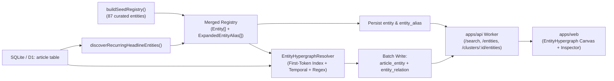
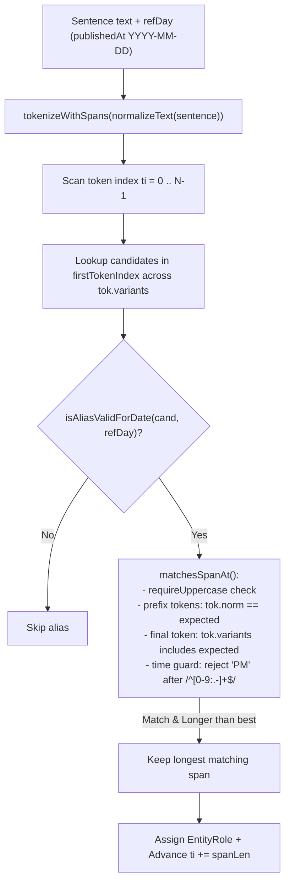

# Jachaikori — Entity Resolution & Article Hypergraph Architecture

**Purpose:** Engineering design review document covering how Jachaikori resolves bilingual (Bangla + English), temporally ambiguous entities across scraped news articles, models articles as entity hypergraphs with sentence-anchored typed relations, and persists/serves those structures on SQLite / Cloudflare D1.

---

## 1. System Context & Design Goals

Jachaikori indexes news articles across nine Bangladeshi Bangla and English outlets (`prothom-alo`, `bangladesh-protidin`, `jugantor`, `kaler-kantho`, `ittefaq`, `daily-star`, `dhaka-tribune`, `business-standard`, `bdnews24`). Downstream verification (claim extraction, cross-outlet framing diffs, and photo-card fact-checking) requires knowing **who** an article mentions and **how** actors interact—without running expensive LLM NER passes on `41,841+` historical articles on every backfill.

The Entity Resolution engine in [`packages/entities`](file:///home/bast0k/projects/jachaikori/packages/entities/src/index.ts) is built around five constraints:

1. **Zero external ML/LLM dependencies at index time:** Pure TypeScript, deterministic, CPU-only, runtime-agnostic (runs in Bun offline backfill CLI and Cloudflare Workers).
2. **Bilingual & morphologically aware:** Handles Unicode NFC/zero-width normalization and inflected Bangla nouns (e.g., `ভারতের` → `ভারত`, `হাসিনাকে` → `হাসিনা`, `ঢাকায়` → `ঢাকা`).
3. **Temporally disambiguated roles:** Role titles such as `PM` / `প্রধানমন্ত্রী` and `Chief Adviser` / `প্রধান উপদেষ্টা` must resolve to different canonical people depending on `article.published_at`.
4. **Hypergraph native:** Each article acts as an **$n$-ary hyperedge** grouping participating entities by semantic role (`quoted_speaker`, `actor`, `subject`, `location`, `mentioned`), overlaid with **pairwise directed/undirected typed edges** grounded in exact evidence sentences.
5. **Dual-role dictionary:** The same canonical `entity` + `entity_alias` tables drive both offline article hypergraph construction and online `/search` FTS5 query expansion.

---

## 2. End-to-End Architecture



---

## 3. Finding Canonical Entities

Canonical resolution combines a **curated bilingual/temporal seed registry** with **corpus-driven dynamic entity discovery**, normalized and indexed into a longest-match-first token prefix structure.

### 3.1 Text Normalization & Conservative Bangla Morphology
Implemented in [`normalize.ts`](file:///home/bast0k/projects/jachaikori/packages/entities/src/normalize.ts):

1. **`normalizeText(text)`**:
   - Applies Unicode `NFC` composition (critical for Bangla decomposed sequences like `য + ়` → `য়`).
   - Strips zero-width joiners/non-joiners and BOM (`[\u200B-\u200D\uFEFF]`, normalizing conjunct variants like `র‍্যাব` → `র্যাব`).
   - Normalizes curly quotes (`‘’` → `'`, `“”` → `"`) and collapses whitespace.
2. **`normalizeToken(raw)`**:
   - Strips leading/trailing punctuation (`EDGE_PUNCT_RE`, including Bangla dari `।` and double-dari `॥`).
   - Strips trailing English possessive `'s` when length `> 2`.
   - Lowercases English while leaving Bangla codepoints (`\u0980-\u09FF`) intact without breaking vowel signs (matras) or *hasanta*.
3. **`getTokenMatchVariants(rawToken)`**:
   - Always emits `[norm]` first.
   - If the token contains Bangla characters (`\u0980-\u09FF`), strips inflections from `BANGLA_SUFFIXES` (ordered longest-first):
     `দেরকে`, `গুলোর`, `গুলো`, `য়ের`, `দের`, `কে`, `তে`, `য়ে`, `ের`, `রা`, `য়`, `র`, `ে`, `এ`.
   - **Conservative stem-length guard:** A 1-character suffix (`য়`, `র`, `ে`, `এ`) is stripped only if `stem.length >= 4`; multi-character suffixes require `stem.length >= 3`. This resolves forms like `সম্মেলনে` → `সম্মেলন`, `ভারতের` → `ভারত`, `বিএনপির` → `বিএনপি`, `হাসিনাকে` → `হাসিনা`, `ঢাকায়` → `ঢাকা` while preventing over-stemming of short root nouns.
4. **`tokenizeWithSpans(text)`**:
   - Emits `TokenSpan` objects tracking `{ raw, norm, variants, hasUppercase, startIndex, endIndex }` so surface spans can be sliced back verbatim from the normalized sentence and uppercase acronym guards can inspect original casing.

### 3.2 Canonical Registry Sources

#### A. Curated Bilingual & Temporal Seed (`RAW_SEED` in [`seed.ts`](file:///home/bast0k/projects/jachaikori/packages/entities/src/seed.ts))
Currently **87 canonical entities** organized into five groups across all five `EntityType` values (`person`, `org`, `location`, `role`, `event_topic`):
1. **Public Figures & Political Leaders (+ Temporal Role Bindings)** — e.g., `ent_tareque_rahman`, `ent_muhammad_yunus`, `ent_sheikh_hasina`, `ent_khaleda_zia`, `ent_mirza_fakhrul`.
2. **Constitutional & Cabinet Roles (Portfolio-Level)** — used when an article cites a portfolio without naming an individual holder (e.g., `ent_role_president`, `ent_role_home_minister` mapping `স্বরাষ্ট্রমন্ত্রী` / `স্বরাষ্ট্র উপদেষ্টা` / `Home Minister` / `Home Adviser`).
3. **Political Parties & Organizations** — parties, security agencies, judicial/regulatory bodies, international orgs (`ent_bnp`, `ent_ncp`, etc.).
4. **Locations** — Bangladesh districts/divisions and key countries/cities.
5. **Major Recurring Event Topics & Sector Entities** — e.g., `ent_topic_rohingya`, `ent_topic_third_terminal`, `ent_topic_cop31`, `ent_topic_pay_scale`, `ent_topic_dengue`, `ent_topic_gold`.

Each alias definition (`SeedAliasSpec`) supports:
- `raw`: Bangla or English surface form (both script variants map to the same canonical `entityId`).
- `validFrom` / `validTo`: ISO date bounds (`YYYY-MM-DD`).
- `requireUppercase`: Boolean flag preventing common lowercase words/units (e.g., `pm`, `us`, `al`) from matching short acronyms (`PM`, `US`, `AL`).

#### B. Automatic Emergent Entity Discovery (`discover.ts`)
Implemented in [`discoverRecurringHeadlineEntities`](file:///home/bast0k/projects/jachaikori/packages/entities/src/discover.ts) to capture recurring news figures not present in the static seed:
- Exploits a pervasive Bangladeshi news headline convention: `<headline claim> : <Speaker Name>` (taking the substring after the last `:` where `colonIdx > 10`).
- Filters tail candidates by:
  - Length `3..36` chars, max `4` whitespace-separated words.
  - No digits (ASCII or Bangla `০-৯`), quotes, `?`, `!`, or `।`.
  - Must be either Bangla script or Title-Cased English proper noun phrase (`^[A-Z][a-z]+(?:\s+[A-Z][a-z]+){0,3}$`).
  - Not already in `existingAliases` and not in `EXCLUDED_SPEAKERS` (~50 generic roles/byline nouns like `নিজস্ব প্রতিবেদক`, `বিশেষ প্রতিনিধি`, `সরকার`, `পুলিশ`, `বিশেষজ্ঞরা`, `উপদেষ্টা`, `minister`, `adviser`, `spokesperson`).
- Promotes speakers occurring at least `minMentions` times (default `8`, capped at `maxEntities = 150`) to canonical `person` entities with deterministic FNV-1a IDs:
  `ent_dyn_<8-hex-fnv1a(norm)>`.

### 3.3 Sentence Matching, Longest-Span Priority & Disambiguation Guards
[`EntityHypergraphResolver`](file:///home/bast0k/projects/jachaikori/packages/entities/src/resolver.ts) compiles all aliases into a hash bucket index keyed by the **first normalized token** (`firstTokenIndex`), sorted descending by `tokens.length`.



Key design details in `matchSentence()`:
1. **Longest-span priority:** Sorted candidate buckets guarantee compound mentions such as `"প্রধানমন্ত্রী তারেক রহমান"` (3 tokens) win over `"প্রধানমন্ত্রী"` (1 token) when starting at the same position, consuming all `spanLen` tokens so sub-aliases inside the same span are not double-counted.
2. **Temporal validity (`isAliasValidForDate`):**
   - Static aliases (`validFrom === null && validTo === null`) are always active.
   - If `refDay` (`publishedAt.slice(0, 10)`) is present, checks `validFrom <= refDay <= validTo`. For example:
     - `PM` / `প্রধানমন্ত্রী` on `2026-11-02` → `ent_tareque_rahman` (`2026-02-17` onward).
     - `PM` / `প্রধানমন্ত্রী` on `2023-09-08` → `ent_sheikh_hasina` (`2009-01-06` .. `2024-08-05`).
     - `প্রধান উপদেষ্টা` / `Chief Adviser` during `2024-08-08` .. `2026-02-16` → `ent_muhammad_yunus`.
   - If `refDay` is missing (`null`), only aliases without a closed `validTo` (`!alias.validTo`) remain eligible (preferring current/unexpired bindings over historical ones).
3. **Bangla multi-word inflection matching:** In `matchesSpanAt()`, prefix tokens `0 .. len-2` require exact `tok.norm === expected`, while the **final token** (`k === len - 1`) matches any suffix-stripped `tok.variants`. This accurately matches multi-word Bangla names where case suffixes attach to the surname (e.g., `"তারেক রহমানের"`, `"সামান্তা শারমিনের"`).
4. **False-positive acronym & timestamp guards:**
   - `requireUppercase` ensures uppercase presence on acronyms (`PM`, `BNP`, `NCP`, `COP31`, `BAJUS`).
   - Special timestamp guard: single-token alias `pm` is rejected if preceded by a numeric/time token matching `/^[0-9:.-]+$/` (so `"Press briefing scheduled at 2 PM"` never links the Prime Minister).

---

## 4. Inferring Hypergraph Structure & Relationships

Once mentions are extracted for an article (`title` as headline sentence + `splitSentences(lead)` + first **35** sentences of `splitSentences(cleanText)`), the engine builds two complementary graph structures per article.

### 4.1 Entity Role Assignment (`article_entity.role`)
Every matched span is assigned one of five hierarchical roles (ordered by merge precedence when the same `(entityId, surfaceForm)` appears multiple times in an article):

| Priority | Role | Trigger Condition in `matchSentence()` |
| :---: | :--- | :--- |
| 5 | `quoted_speaker` | Entity appears in headline speaker tail (`colonIdx > 8`, after `:`, tail length `< 45`), **OR** entity sits within `[-30, +35]` chars of a Bangla/English speech verb (`বলেন`, `বলেছেন`, `জানান`, `জানিয়েছেন`, `মন্তব্য করেন`, `দাবি করেন`, `উল্লেখ করেন`, `হুঁশিয়ারি`, `said`, `says`, `told`, `stated`, `noted`, `warned`, `according to`). |
| 4 | `actor` | Appears early in the headline (`isHeadline && ti <= 2`) and is not a location or quoted speaker. |
| 3 | `subject` | Appears later in the headline (`isHeadline && ti > 2`). |
| 2 | `location` | Entity has `entityType === 'location'`. |
| 1 | `mentioned` | Appears in lead/body without qualifying for the above roles. |

Confidence scores are assigned deterministically by structural salience: `0.95` for headline mentions (`isHeadline === true`) and `0.85` for lead/body mentions.

Each article therefore defines a **hyperedge** over its distinct resolved `entityId`s (plus per-entity roles and verbatim surface forms).

### 4.2 Sentence-Anchored Typed Relations (`entity_relation`)
To avoid spurious document-wide Cartesian links, **relations are extracted strictly within single sentence boundaries** (`uniqueInSentence`). If a sentence contains at least 2 distinct entities, up to the first **5** unique entities in that sentence (`uniqueInSentence.slice(0, 5)`) are paired to prevent quadratic explosion on list-heavy sentences.

For each pair `(a, b)`, `classifySentenceRelation(sentence, a, b)` evaluates rules in strict precedence order:

| Precedence | `relationType` | Detection Rule & Edge Orientation |
| :---: | :--- | :--- |
| 1 | `quoted_about` | Triggered if exactly one endpoint has `role === 'quoted_speaker'`. Always oriented **`quoted_speaker` → non-speaker**. |
| 2 | `resigned_from` | Regex match for resignation/departure verbs (`পদত্যাগ`, `অব্যাহতি`, `ছেড়েছেন`, `ছেড়েছেন`, `resign(ed/s/ation)`, `step(s/ped) down`). Preserves sentence order `a -> b`. |
| 3 | `legal_action` | Arrest/detention/case/bail/court terms (`গ্রেপ্তার`, `আটক`, `মামলা`, `জামিন`, `হাতকড়া`, `ট্রাইব্যুনাল`, `হাইকোর্ট`, `সুপ্রিম কোর্ট`, `arrest*`, `detain*`, `indict*`, `verdict`, `hearing`, `court`). |
| 4 | `criticized_or_protested` | Protest/criticism/accusation/opposition markers (`বিক্ষোভ`, `প্রতিবাদ`, `সমালোচনা`, `অভিযোগ`, `ক্ষোভ`, `হুঁশিয়ারি`, `পাল্টা`, `বিরুদ্ধে`, `protest*`, `criticiz*`, `accus*`, `demand*`, `against`). |
| 5 | `met_with` | Meetings/talks/summits/visits (`সাক্ষাৎ`, `বৈঠক`, `আলাপ`, `সম্মেলন`, `সফর`, `met`, `meeting`, `talks`, `summit`, `visit*`). |
| 6 | `announced_or_agreed` | Announcements/orders/agreements/loans (`ঘোষণা`, `প্রজ্ঞাপন`, `নির্দেশ`, `সিদ্ধান্ত`, `চুক্তি`, `ঋণ`, `অনুমোদন`, `announc*`, `approv*`, `pledg*`, `sign*`, `directive`). |
| 7 | `located_in` | Fallback when either endpoint has `entityType === 'location'`. |
| 8 | `co_occurred` | Default fallback when two non-location entities co-occur in the same sentence without an explicit event cue. Canonicalized lexicographically (`src.entityId < tgt.entityId`) so symmetric co-occurrences never duplicate. |

Deduplication & Provenance:
- Deduplicated per article on `(sourceEntityId, targetEntityId, relationType)` with deterministic ID `rel_<16-hex-fnv1a>` hashed from `[article.id, sourceEntityId, targetEntityId, relationType]`.
- Stores verbatim sentence `evidenceSnippet` (truncated at `220` chars) and relation `confidence` (`0.92` headline, `0.80` lead/body).

---

## 5. Database Schema & Data Models

### 5.1 Storage Topology (Local Index vs. Cloudflare Production)
All schemas mirror identically between local development and production:
- **Local SQLite (`data/index/index.sqlite`)** managed by [`IndexDatabase`](file:///home/bast0k/projects/jachaikori/tools/backfill/src/db.ts): contains all relational + FTS5 tables **plus** two local binary float32 tables (`chunk_vector` and `article_vector`) used by offline BGE-M3 clustering and NDJSON export.
- **Cloudflare D1** defined by forward-only migrations [`0001_initial.sql`](file:///home/bast0k/projects/jachaikori/apps/api/migrations/0001_initial.sql) and [`0002_entity_hypergraph.sql`](file:///home/bast0k/projects/jachaikori/apps/api/migrations/0002_entity_hypergraph.sql), paired with Cloudflare Vectorize (`jachaikori-chunks`) for semantic chunk search.

### 5.2 Entity-Relationship Diagram

```mermaid
erDiagram
    article ||--o{ chunk : "has passages"
    article ||--o| article_cluster : "belongs to"
    event_cluster ||--o{ article_cluster : "groups"
    article ||--o{ article_similarity_edge : "similar_to (source/target)"
    article ||--o{ article_entity : "hyperedge member"
    entity ||--o{ article_entity : "mentioned in"
    entity ||--o{ entity_alias : "known by (temporal)"
    article ||--o{ entity_relation : "evidences"
    entity ||--o{ entity_relation : "source/target"

    article {
        TEXT id PK
        TEXT outlet
        TEXT canonical_url UK
        TEXT title
        TEXT published_at
        TEXT byline
        TEXT lead
        TEXT clean_text
        TEXT pipeline_version
    }

    entity {
        TEXT id PK
        TEXT canonical_bn
        TEXT canonical_en
        TEXT entity_type
        TEXT metadata_json
    }

    entity_alias {
        TEXT alias_norm PK
        TEXT entity_id PK_FK
        TEXT alias_raw
        TEXT valid_from
        TEXT valid_to
    }

    article_entity {
        TEXT article_id PK_FK
        TEXT entity_id PK_FK
        TEXT surface_form PK
        TEXT chunk_id
        TEXT role
        REAL confidence
    }

    entity_relation {
        TEXT id PK
        TEXT article_id FK
        TEXT source_entity_id FK
        TEXT target_entity_id FK
        TEXT relation_type
        TEXT evidence_snippet
        TEXT published_at
        REAL confidence
    }
```

### 5.3 Table Breakdown & Indexing Decisions

1. **Core Article & Bangla FTS5 Tables (`0001_initial.sql`):**
   - `article`: Stores normalized article metadata and extracted text (`idx_article_outlet_date(outlet, published_at DESC)`).
   - `chunk`: Paragraph-aware chunks derived from `article` (`id` format `<articleId>:<position>`).
   - `chunk_fts` (FTS5 external-content virtual table synced via `chunk_ai` / `chunk_ad` triggers): Uses a custom Bangla-safe `unicode61` tokenizer preserving all 19 Bangla combining marks (`tokenchars 'ঁংঃ়ািীুূৃৄেৈোৌ্ৗৢৣ'`, `remove_diacritics 0`) so SQLite does not split Bangla words on vowel matras or *hasanta*.
   - `event_cluster`, `article_cluster`, `article_similarity_edge`: Temporal cosine similarity graph built from 1024-d BGE-M3 article centroid embeddings (`±windowDays` + centroid guard).
2. **Entity Registry & Hypergraph Tables (`0001_initial.sql` + `0002_entity_hypergraph.sql`):**
   - `entity`: Canonical dictionary (`id` such as `ent_tareque_rahman` or `ent_dyn_<fnv1a>`), optional `canonical_bn` / `canonical_en`, `entity_type`, and `metadata_json`.
   - `entity_alias`: Compound PK `(alias_norm, entity_id)` indexed by `idx_alias_norm(alias_norm)`. Critically, the compound PK permits the **same normalized alias string** (e.g., `pm`, `প্রধানমন্ত্রী`) to point to **multiple canonical entities** with disjoint `[valid_from, valid_to]` ranges.
   - `article_entity`: Compound PK `(article_id, entity_id, surface_form)` preserving exact morphological surface variants per article. Migration `0002` adds `role TEXT NOT NULL DEFAULT 'mentioned'` plus `idx_article_entity_aid(article_id)` (complementing `idx_article_entity_eid(entity_id)` for bidirectional cluster-to-entity and entity-to-article lookups).
   - `entity_relation`: Stores typed pairwise edges grounded in an article and `evidence_snippet`. Indexed along all four query dimensions: `idx_rel_article`, `idx_rel_source`, `idx_rel_target`, and `idx_rel_type`.

### 5.4 TypeScript & Zod Data Contracts ([`packages/schema`](file:///home/bast0k/projects/jachaikori/packages/schema/src/entity.ts))

| Schema | Role in Pipeline | Key Fields |
| :--- | :--- | :--- |
| `EntitySchema` | Canonical node identity | `id`, `canonicalBn`, `canonicalEn`, `entityType` (`person \| org \| location \| role \| event_topic`), `metadataJson` |
| `EntityAliasSchema` | Temporal & bilingual surface lookup | `aliasNorm`, `aliasRaw`, `entityId`, `validFrom`, `validTo` |
| `ArticleEntityMentionSchema` | Hyperedge membership row | `articleId`, `entityId`, `chunkId`, `surfaceForm`, `role` (`EntityRoleSchema`), `confidence` |
| `EntityRelationSchema` | Typed pairwise edge row | `id`, `articleId`, `sourceEntityId`, `targetEntityId`, `relationType` (`EntityRelationTypeSchema`), `evidenceSnippet`, `publishedAt`, `confidence` |
| `EntityGraphResponseSchema` | Projected subgraph for API & UI | `centerEntity`, `clusterLabel`, `nodes` (`EntityGraphNode[]` w/ `mentionCount` + `roles[]`), `edges` (`EntityGraphEdge[]` aggregated across articles w/ `weight` + up to 6 `evidence[]` snippets), `hyperedges` (`EntityHyperedge[]` mapping each article to `entityIds[]` + `roleByEntity`) |
| `ClusterGraphResponseSchema` | Article cluster graph + top entities | Includes optional `entities: EntitySummary[]` (top 25 entities in that event cluster) |
| `ClaimSchema` *(Phase 3 target)* | Downstream structured fact atom | `subject`, `predicate`, `object`, `attributedSpeaker`, `isQuote`, `claimedNumbers[]`, `claimedDates[]` ([`claim.ts`](file:///home/bast0k/projects/jachaikori/packages/schema/src/claim.ts)) |

---

## 6. Runtime Query Expansion & Graph Projection

### 6.1 Search Integration (`AliasDictionaryExpander` in [`apps/api/src/index.ts`](file:///home/bast0k/projects/jachaikori/apps/api/src/index.ts))
During `GET/POST /search`:
1. The API loads `entity_alias` rows from D1 and initializes [`AliasDictionaryExpander`](file:///home/bast0k/projects/jachaikori/packages/retrieval/src/query-expander.ts).
2. `expander.expand(params.query, params.toDate)` matches query tokens/substrings against `aliasNorm` within `[validFrom, validTo]` (when `toDate` is supplied) and collects **all temporally valid sibling aliases** for matched entities (cross-script + spelling variants).
   - Example verified query `"PM"` at `toDate = 2026-11-15` expands to `["তারেক রহমান", "Tarique Rahman", "Tareque Rahman", "প্রধানমন্ত্রী তারেক রহমান", "প্রধানমন্ত্রী", "Prime Minister"]`.
3. Expanded terms are OR-joined into `chunk_fts` BM25 keyword retrieval via [`buildFtsMatchQuery`](file:///home/bast0k/projects/jachaikori/packages/retrieval/src/bangla.ts) (up to 16 unique quoted tokens), then fused with Vectorize `bge-m3` semantic hits via Reciprocal Rank Fusion (`k = 60`).

### 6.2 API Hypergraph Endpoints ([`apps/api/src/index.ts`](file:///home/bast0k/projects/jachaikori/apps/api/src/index.ts))
- `GET /health` — Reports counts including `entities` and `entityRelations`.
- `GET /entities?q=&type=&limit=` — Ranked entity catalog filtered by `entity_type` or alias substring (`HAVING articleCount > 0`, ordered by `articleCount DESC`).
- `GET /entities/:id/graph` — Builds an ego-centered hypergraph via `buildEntityHypergraphPayload({ centerEntityId, maxRelations: 200 })`, capped at the **top 24 co-occurring neighbors** by relation frequency so the canvas remains legible.
- `GET /clusters/:id/entities` — Projects all entities, aggregated typed relation edges, and up to **30** article hyperedge hulls (`scopedArticles` capped at 40) within a cross-outlet event cluster.
- `GET /clusters/:id/graph` — Attaches the top 25 canonical `entities` alongside article similarity nodes/edges.

---

## 7. Observed Backfill Telemetry

Running `bun run backfill resolve-entities` ([`cli.ts`](file:///home/bast0k/projects/jachaikori/tools/backfill/src/cli.ts)) on the local corpus produced:

| Metric | Measured Result |
| :--- | :--- |
| Corpus size processed | `41,841` articles (batch commits every `4,000` mentions/relations) |
| Canonical entities | `188` (`87` curated seed + `101` auto-discovered from headline `: <Speaker>`) |
| Articles linked to >=1 entity | `40,242 / 41,841` (`96.2%`) |
| Total `article_entity` rows | `225,618` |
| Total `entity_relation` edges | `139,123` |
| End-to-end runtime | `81.8s` |

---

## 8. Tradeoffs, Known Gaps & Questions for Peer Review

To calibrate whether anything needs tightening before Sprint 5/6 (Photo-Card Verification & Claim Diff):

1. **Multi-word Bangla inflections on non-final tokens:**
   `matchesSpanAt()` only strips suffixes on the *last* token of a multi-word alias (`isLast ? tok.variants.includes(expected) : tok.norm === expected`). Titles or orgs whose inflection occurs mid-phrase will miss, though most Bangla postpositions/case markers attach to the final word.
2. **Recall boundary for unseeded non-speaker entities:**
   `discoverRecurringHeadlineEntities()` only promotes entities appearing after `:` in headlines (`minMentions = 8`). Recurring mid-headline organizations, obscure locations, or people who are acted upon without being headline-quoted are missed unless added to `RAW_SEED` or supplemented by a batch LLM/NER discovery pass.
3. **Rule-based relation classification vs. negation/clause scope:**
   `classifySentenceRelation()` classifies all pairs `(<= 5)` in a sentence using a single sentence-level verb regex precedence cascade. Multi-clause Bangla compound sentences (e.g., *"X met Y while Z criticized W"*) will assign the highest-precedence relation across every entity pair in that sentence rather than parsing clause boundaries.
4. **No cross-sentence coreference resolution:**
   Pronouns (`তিনি`, `তাঁর`, `উনি`, `he`, `she`) and bare honorifics (`মন্ত্রী`, `মুখপাত্র`) in sentence $N+1$ are not resolved back to the subject of sentence $N$, meaning body-text relations rely on explicit entity re-mentions within the same sentence (within the first 35 body sentences).
5. **Query-time expansion subtle mismatch with index-time guards:**
   In [`query-expander.ts`](file:///home/bast0k/projects/jachaikori/packages/retrieval/src/query-expander.ts), `AliasDictionaryExpander` runs substring `normQuery.includes(aliasKey)` without checking `requireUppercase`, and only applies temporal `[validFrom, validTo]` filtering when `toDate` is provided by the caller (whereas a search query for `"PM"` with no `toDate` expands *both* 2009–2024 and 2026+ holders). Also, `/search` currently fetches all `entity_alias` rows per request (fine at ~500 aliases, should be memoized per Worker isolate or indexed via token lookup if the alias dictionary grows into the tens of thousands).
6. **Full registry rebuild vs. incremental Delta updates:**
   `bun run backfill resolve-entities` currently executes `replaceEntityRegistryAndClearHypergraph()` and recomputes all articles (`81.8s` for 41.8k articles). For continuous Cloudflare Queue ingestion (`apps/ingest`), we will want an incremental single-article resolver path (loading cached seed+D1 `entity_alias` rows and upserting only that article's `article_entity` + `entity_relation` rows).
7. **Bridging Sprint 4 Hypergraph → Phase 3 `ClaimSchema`:**
   Look at Section 5.4: right now `article_entity` + `entity_relation` give us coarse entity-event links (`quoted_about`, `resigned_from`, etc.) and sentence snippets, whereas `ClaimSchema` adds `claimedNumbers[]`, `claimedDates[]`, and finer predicates for cross-outlet **Claim Diff**. Open design decision: should Claim Diff extract `Claim` atoms on demand per `/clusters/:id` or store persistent `claim` rows linked back to `entity.id`?
