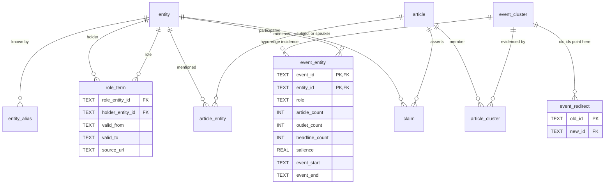
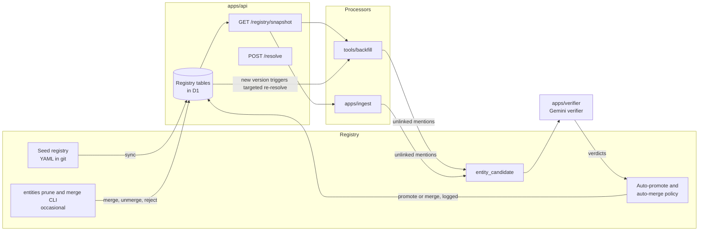

# Jachaikori — Entity Engine: Review, Architecture, Visualization, and Agent Instructions (v2)

2026-11-18 · Updated with your four decisions · Adds the visualization code (section 8)

## 1. Verdict

**The direction is right, but two things need to change.**

1. **The hyperedge is the wrong unit.** Right now each *article* is a hyperedge over its entities. That is a bag of entities, the same information as a co-occurrence table. A hyperedge becomes meaningful when it is an **event**: one thing that happened, with several participants, reported by several articles and outlets. Your vision (edge = event, opens into a graph) is correct. The implementation should match it: the cluster is the hyperedge, and articles are its evidence.
2. **The entity universe is closed.** 188 entities cannot support "explore the news through its entities". The valuable part of Bangladeshi news is the long tail: district officials, company heads, local organizations. The next big step is a loop that discovers and promotes new entities automatically, not a better matcher.

Keep: the pure-TypeScript deterministic resolver, temporal aliases, longest-span matching, conservative Bangla suffix stripping, sentence-anchored evidence, the `: Speaker` headline discovery.

Do not adopt a graph database or hypergraph library. A hypergraph is a modeling lens. In SQL it is an **incidence table** (`event_entity`), which is what you will build.

## 2. Your decisions and what they change

| # | Decision | Consequence |
| --- | --- | --- |
| 1 | Only the categories you crawl | Mining reads only the catalog you already have, so scope is automatic. The mining prompt tells the model to ignore generic nouns and anything outside news about those categories. The five entity types stay as they are. |
| 2 | Gemini budget: okay | Mining runs with hard token and cost guards. First run is a report-only measurement on 200 articles; extrapolate before any larger run. |
| 3 | No routine curation; auto-populate | Promotion and merging become **automatic with strict thresholds, an audit log and undo**. A `prune` command exists for your occasional visit. Principle: **a duplicate entity is cheaper than a wrong merge**, so the system prefers splitting when unsure. |
| 4 | Cluster tables are wiped and IDs recomputed from the highest-degree seed article | IDs are deterministic but not permanent: when a cluster gains articles or merges with another, its seed article can change and so can its ID. Everything derived from clusters (`event_entity`) must be rebuilt in the same run, and old event URLs need **redirects** (code in 4.3). |

## 3. What to check before trusting the numbers

The telemetry in your notes measures coverage, not correctness. 96.2% of articles linking to at least one entity mostly means "Bangladesh", "Dhaka" and "PM" appear in most news. Run these first:

- Top 30 entities by article count. If a few locations and roles dominate, the graph will be a hairball.
- Histogram of `relation_type`. I expect `co_occurred` and `located_in` to dominate, which would mean most of the 139k relations carry little information.
- 50 random relations with their snippets, judged by hand. This is the real precision check on the regex classifier.
- 50 random `PM` / `প্রধানমন্ত্রী` resolutions.

**Likely bug: foreign leaders.** "ভারতের প্রধানমন্ত্রী নরেন্দ্র মোদি" or "Indian Prime Minister Modi" can bind the bare role alias to the Bangladeshi holder. Longest-span only helps when the span includes a *known* name. Two guards are needed:

- No bare-role binding when a country or nationality qualifier precedes the role.
- `<role> <unknown name>` is apposition: emit an unlinked mention with role context, not a link to the holder.

**Sizing.** If the 41,841 articles are the 3-week test window, the year-to-date corpus is roughly 600k articles. At your measured density (about 5.4 mentions and 3.3 relations per article) that is around 3.4M mention rows and 2M relation rows. D1 can hold that, but keep it lean: aggregated event rows and headline/lead mentions in D1; `co_occurred` relations and body-only hub mentions stay local or are computed on demand.

## 4. Model: entities, events, articles



### 4.1 Layers

- **Entity** is the node: person, org, location, role, topic.
- **Event** is the hyperedge: an `event_cluster` with a time span, a label (the medoid headline) and one `event_entity` row per participant.
- **Article** is evidence. Mentions live in `article_entity` and are aggregated upward into `event_entity`.
- **Claim** is the Phase 3 atom. It replaces most of the regex `entity_relation`.

### 4.2 Role terms

Today "PM" and "প্রধানমন্ত্রী" are duplicated alias rows per holder, each with dates. Instead, the alias maps once to the role entity (`ent_role_prime_minister`), and `role_term(role, holder, valid_from, valid_to, source_url)` answers "who held it on date D". It is a join, can be validated (no overlapping terms for one role) and records a source.

### 4.3 Cluster IDs that change (decision 4)

`event_entity` is derived data, so the rule is: **cluster, then materialize `event_entity`, then compute redirects, all in one run.** Entity-side data (`article_entity`, claims) does not depend on cluster IDs and is unaffected.

Compute redirects before wiping, by tracing where each old cluster's articles went:

```ts
// tools/backfill/src/cluster-redirects.ts
export interface Redirect { oldId: string; newId: string }

/** prev/next map articleId -> eventId, taken before and after re-clustering. */
export function buildRedirects(
  prev: Map<string, string>,
  next: Map<string, string>,
  minOverlap = 0.5,
): Redirect[] {
  const sizes = new Map<string, number>();
  const hits = new Map<string, Map<string, number>>();
  for (const [articleId, oldId] of prev) {
    sizes.set(oldId, (sizes.get(oldId) ?? 0) + 1);
    const newId = next.get(articleId);
    if (!newId) continue;
    const m = hits.get(oldId) ?? new Map<string, number>();
    m.set(newId, (m.get(newId) ?? 0) + 1);
    hits.set(oldId, m);
  }
  const out: Redirect[] = [];
  for (const [oldId, m] of hits) {
    const [newId, n] = [...m].sort((a, b) => b[1] - a[1])[0];
    if (newId !== oldId && n / sizes.get(oldId)! >= minOverlap) out.push({ oldId, newId });
  }
  return out;
}
```

Notes:

- Collapse chains on insert (`UPDATE event_redirect SET new_id = :new WHERE new_id = :old`), so lookups are one hop.
- `GET /events/:id` returns a redirect to the new ID when `id` is in `event_redirect`, and a "this event was merged or split" page otherwise.
- On D1, a wipe-and-reload is not atomic across batches. Load the new run behind a `run_id` pointer and flip the pointer at the end, or run the rebuild in a quiet window. Local SQLite does not have this problem.

## 5. Where the engine lives

- **`packages/entities`** stays a pure library: `compileRegistry(snapshot)` and `resolveArticle(article, compiled)`. No network, no storage.
- **`apps/api` owns the registry.** It is the system of record and serves versioned snapshots.
- **Processors fetch a snapshot and resolve locally.** The backfill CLI and `apps/ingest` pull `GET /registry/snapshot`, compile once per process or isolate, and run the library. No network call per article: your 81.8 s for 41.8k articles (about 2 ms each) shows resolution is cheap, and a call per article would dominate it.
- **`POST /resolve`** exists for ad hoc text: the photo-card text from the verifier, UI typeahead, debugging.
- Every resolution is stamped with `registry_version` and `resolver_version`, so stale articles are identifiable.



**Source of truth.** Keep the curated seed (the 87 entities and role terms) as YAML in git. You get reviewable diffs, CI validation (no overlapping role terms, no unexplained alias collisions), and a frozen registry for eval. Sync git to D1 one way for `source='seed'` rows. Auto-created entities live in D1 only.

## 6. Making resolution more accurate (fully automatic)

### 6.1 Open the vocabulary: dictionary at runtime, models as offline miners

Keep your constraint: no LLM NER per article at index time. Use models only to grow the dictionary.

1. **Rule-based candidate generators** emit `UnlinkedMention`s while resolving: unmatched capitalized English n-grams; Bangla `<title> <name>` patterns (triggers such as মন্ত্রী, সচিব, মহাসচিব, সভাপতি, চেয়ারম্যান, অধ্যাপক, ডা., ড., জনাব, কমিশনার, মহাপরিচালক, মুখপাত্র); `Name, <description>` appositions; your existing `: Speaker` tail.
2. **Aggregate** into `entity_candidate` keyed by normalized form: document frequency, outlet count, distinct days, sample sentences, guessed type.
3. **Verify in batch** with Gemini through `apps/verifier` (`POST /mine-entities`): structured JSON output asking for `is_named_entity`, type, canonical Bangla and English forms, and "same as existing entity X?". Cache by input hash plus prompt version. Enforce `--max-tokens` and `--max-usd`; the `--report-only` mode prints a token estimate without calling the model.
4. **Optional bootstrap**: run the same prompt over title plus lead (not full text) for about 3,000 stratified articles to seed candidates faster.

### 6.2 Auto-promotion policy

Starting thresholds (tune on the gold set from 6.5):

| Candidate type | Articles | Outlets | Distinct days | Extra conditions |
| --- | --- | --- | --- | --- |
| person | ≥ 12 | ≥ 3 | ≥ 6 | LLM says named entity and same type in ≥ 80% of at least 3 samples; at least two name tokens (single-token persons never auto-promote); not a generic title |
| org, location, topic | ≥ 8 | ≥ 2 | ≥ 4 | LLM says named entity and same type in ≥ 80% of samples |

- **Collision guard.** If a candidate's tokens are a subset of an existing active entity's alias tokens, create a *merge proposal* instead of a new entity.
- **Rejected forms** (LLM says not an entity, or you rejected it in `prune`) are written to a denylist and never proposed again.
- **Audit fields.** Auto-created rows carry `source='auto'`, `auto_score`, and the verdict JSON, so you can see why they exist.

### 6.3 Auto-merge policy

Merge two entities automatically only if **all** hold:

- same type;
- they share at least 3 event clusters (cross-script pairs usually meet in cross-outlet clusters);
- name-embedding cosine (BGE-M3, cross-lingual) is above a threshold calibrated on the gold set;
- an LLM judge answers "same entity?" with confidence at least 0.8.

Person merges additionally require no conflicting-surname evidence. Every merge writes `entity_merge_log` (from, to, reasons, timestamp, `undone_at`). Merging sets `entity.merged_into`, and readers follow the redirect. `entities unmerge <logId>` reverses it. When unsure, leave both entities alone.

### 6.4 Your occasional visit

`entities prune --dry-run` proposes:

- auto entities with no mentions in 60 days and fewer than 20 total;
- entities whose top surface forms the LLM judges generic;
- aliases shared by three or more entities.

Commands: `entities merge A B`, `entities unmerge <logId>`, `entities reject X` (adds to the denylist and sets `status='rejected'`).

### 6.5 Resolver fixes (pure package)

- **Role guard** and apposition handling (section 3).
- **`linkMethod` and `linkConfidence`** replace the constant confidences: `name_exact`, `alias_stem`, `role_dated`, `role_inferred`, `article_coref`. Keep `salience` (headline versus body) separate. A bare "the Prime Minister" in a historical article is `role_inferred` and scores low.
- **Article-local coreference.** After a full name is linked, resolve a later surname-only or first-name-only mention to it when unambiguous in that article. Skip pronouns.
- **Stem comparison on every token** position, which fixes your gap 1.
- **Speech-verb window.** Bangla is verb-final, so the speaker is often further than 30 characters from `বলেন`. Measure recall before changing the window.
- **Query-time expansion** (your note 5): match on tokens or whole phrases, not `includes` (`us` matches inside `business`); share `isAliasValidForDate` and `requireUppercase` with the resolver; with no date given, default role aliases to today; memoize the compiled index per isolate, keyed by `registry_version`.

### 6.6 Measure it

Build a gold set before expanding:

- 150 to 200 articles, stratified by outlet, language and topic, with a good share around known role changes.
- Annotations: mentions (span, entity ID or `NIL`, type) and roles for a subset. Pre-annotate with Gemini, correct by hand.
- Metrics: mention precision, recall and F1 (strict and lenient), linking accuracy, NIL handling, temporal-role correctness, and relation precision on 300 hand-judged edges.
- Run in CI against a frozen registry snapshot; fail on regression.

Auto-promotion and auto-merge thresholds should be tuned against this set, since there is no human reviewing the results day to day.

## 7. Event layer

After clustering, materialize `event_entity` from `article_entity` and `article_cluster`:

- An entity participates in an event if it is in the headline of any member article, or mentioned in at least k of its articles.
- `salience` combines share of articles, headline count, outlet count and role weight.
- Denormalize `event_start` onto each row. Index `(entity_id, event_start)` and `(event_start)`.

**Avoiding the hairball.** Rank related entities by association against the baseline, not by raw counts, and hide hubs by default. Association is PMI damped for rare pairs, computed in the Worker:

```ts
// packages/entities/src/association.ts
/**
 * PMI of (center, other) over events in a time window.
 * together = events containing both, nMe = events containing center,
 * totalOther = events containing other, nAll = all events in the window.
 */
export function associationScore(
  together: number,
  totalOther: number,
  nMe: number,
  nAll: number,
): number {
  const pmi = Math.log((together * nAll) / (nMe * totalOther));
  return pmi * Math.log(1 + together); // damp pairs seen only once or twice
}
```

## 8. Visualizing the entities

The UI has three views, matching your vision: an **entity view across time** (events as hollow circles aligned on a time axis, co-participants as shaped nodes), a **time brush** that sets the window, and an **event view** (the graph inside one event, with evidence). I use D3 with plain SVG, because it works in any framework, handles the roughly 100 nodes these views are capped at, and keeps Bangla text selectable and accessible. If `apps/web` already uses React, Svelte or Astro, call the same functions from the component's mount lifecycle (example in 8.7).

```
apps/web/src/lib/entity-viz/
├─ types.ts          # response shapes
├─ api.ts            # fetch helpers
├─ style.ts          # colors, shapes, labels
├─ state.ts          # URL state (entity, filters, window)
├─ egoGraph.ts       # entity across time
├─ activityBrush.ts  # time window selector
└─ eventGraph.ts     # graph inside one event
```

```bash
cd apps/web && bun add d3 && bun add -d @types/d3
```

Load a Bangla-capable font (for example Noto Sans Bengali) and set it on the SVG elements. SVG text does not wrap, so long Bangla labels are kept short on the canvas and shown in full in `<title>` tooltips and in the side panel.

### 8.1 Types

```ts
// types.ts
export type EntityType = 'person' | 'org' | 'location' | 'role' | 'event_topic';
export type Lang = 'bn' | 'en';

export interface EntityNode {
  id: string;
  label: { bn: string | null; en: string | null };
  type: EntityType;
  eventCount: number;   // events in the selected window
  score?: number;       // association with the center entity
}

export interface EventNode {
  id: string;
  label: string;        // medoid headline
  start: string;        // ISO date
  end: string;
  articleCount: number;
  outletCount: number;
}

export interface Incidence { eventId: string; entityId: string; role: string; salience: number }

export interface EgoResponse {
  center: EntityNode;
  entities: EntityNode[];
  events: EventNode[];
  incidence: Incidence[];
}

export interface ActivityPoint { day: string; articleCount: number }  // YYYY-MM-DD

export interface EventEdge {
  source: string;
  target: string;
  relationType: string;
  weight: number;
  evidence: { articleId: string; outlet: string; snippet: string }[];
}

export interface EventGraphResponse {
  event: EventNode;
  entities: (EntityNode & { roles: string[]; salience: number })[];
  edges: EventEdge[];
}
```

### 8.2 API helpers

```ts
// api.ts
import type { ActivityPoint, EgoResponse, EventGraphResponse, EventNode } from './types';

const API = import.meta.env.PUBLIC_API_URL as string; // adjust for your framework

async function get<T>(path: string, params: URLSearchParams): Promise<T> {
  const res = await fetch(`${API}${path}?${params}`);
  if (!res.ok) throw new Error(`${path} ${res.status}`);
  return res.json() as Promise<T>;
}

export const getEgo = (id: string, from: string, to: string, hubs = false) =>
  get<EgoResponse>(`/entities/${encodeURIComponent(id)}/ego`, new URLSearchParams({ from, to, hubs: hubs ? '1' : '0' }));

export const getActivity = (id: string, from: string, to: string) =>
  get<ActivityPoint[]>(`/entities/${encodeURIComponent(id)}/activity`, new URLSearchParams({ from, to }));

export const getEventGraph = (eventId: string) =>
  get<EventGraphResponse>(`/events/${encodeURIComponent(eventId)}/graph`, new URLSearchParams());

/** Events in which ALL listed entities participated (the hyperedge intersection query). */
export function getEvents(entityIds: string[], from: string, to: string) {
  const q = new URLSearchParams({ from, to });
  entityIds.forEach((id) => q.append('entity', id));
  return get<EventNode[]>('/events', q);
}
```

### 8.3 Style: shape and color encode entity type

Color alone is not accessible, so shape carries the type too.

```ts
// style.ts
import * as d3 from 'd3';
import type { EntityNode, EntityType, Lang } from './types';

export const TYPE_COLOR: Record<EntityType, string> = {
  person: '#2563eb',
  org: '#7c3aed',
  location: '#059669',
  role: '#d97706',
  event_topic: '#db2777',
};

const TYPE_SYMBOL: Record<EntityType, d3.SymbolType> = {
  person: d3.symbolCircle,
  org: d3.symbolSquare,
  location: d3.symbolDiamond,
  role: d3.symbolTriangle,
  event_topic: d3.symbolStar,
};

export const labelFor = (e: Pick<EntityNode, 'id' | 'label'>, lang: Lang): string =>
  (lang === 'bn' ? e.label.bn ?? e.label.en : e.label.en ?? e.label.bn) ?? e.id;

/** SVG path for a type's symbol with the given radius (symbol size is area). */
export const symbolPath = (type: EntityType, r: number): string =>
  d3.symbol(TYPE_SYMBOL[type], Math.PI * r * r)() ?? '';
```

### 8.4 Entity across time

Events are pinned horizontally by start date, so the picture reads as a timeline. Each entity sits at the average position of the events it took part in. Entities are filled shapes; events are hollow circles sized by article count. Clicking an entity re-centers on it; clicking an event opens the event view.

```ts
// egoGraph.ts
import * as d3 from 'd3';
import type { EgoResponse, EntityNode, EventNode, Lang } from './types';
import { TYPE_COLOR, labelFor, symbolPath } from './style';

type N = d3.SimulationNodeDatum & {
  id: string;
  kind: 'entity' | 'event';
  r: number;
  tx: number;              // target x on the time axis
  entity?: EntityNode;
  event?: EventNode;
};
type L = d3.SimulationLinkDatum<N> & { salience: number };

export interface EgoOptions {
  width: number;
  height: number;
  lang: Lang;
  onEntity: (id: string) => void;
  onEvent: (id: string) => void;
}

/** Renders the graph and returns a cleanup function. */
export function renderEgo(svgEl: SVGSVGElement, data: EgoResponse, o: EgoOptions): () => void {
  const { width, height, lang } = o;
  const margin = 48;
  const svg = d3.select(svgEl).attr('viewBox', `0 0 ${width} ${height}`);
  svg.selectAll('*').remove();
  const g = svg.append('g');

  // Time axis: events are pinned by start date.
  const times = data.events.map((e) => +new Date(e.start));
  const t0 = d3.min(times) ?? Date.now();
  const t1 = d3.max(times) ?? t0 + 864e5;
  const x = d3
    .scaleUtc()
    .domain([new Date(t0), new Date(t1 === t0 ? t0 + 864e5 : t1)])
    .range([margin, width - margin]);

  const eventX = new Map(data.events.map((e) => [e.id, x(new Date(e.start))]));

  // Each entity sits at the mean x of the events it participated in.
  const acc = new Map<string, { sum: number; n: number }>();
  for (const i of data.incidence) {
    const ex = eventX.get(i.eventId);
    if (ex === undefined) continue;
    const a = acc.get(i.entityId) ?? { sum: 0, n: 0 };
    a.sum += ex;
    a.n += 1;
    acc.set(i.entityId, a);
  }

  const nodes: N[] = [
    ...data.entities.map((e) => {
      const a = acc.get(e.id);
      return {
        id: e.id,
        kind: 'entity' as const,
        entity: e,
        r: 6 + 2.5 * Math.sqrt(e.eventCount),
        tx: a ? a.sum / a.n : width / 2,
      };
    }),
    ...data.events.map((ev) => ({
      id: ev.id,
      kind: 'event' as const,
      event: ev,
      r: 4 + 2 * Math.sqrt(ev.articleCount),
      tx: eventX.get(ev.id) ?? width / 2,
    })),
  ];

  const center = nodes.find((n) => n.id === data.center.id);
  if (center) {
    center.fx = width / 2;
    center.fy = height / 2;
  }

  const ids = new Set(nodes.map((n) => n.id));
  const links: L[] = data.incidence
    .filter((i) => ids.has(i.entityId) && ids.has(i.eventId))
    .map((i) => ({ source: i.entityId, target: i.eventId, salience: i.salience }));

  // Adjacency (built before d3 replaces link endpoints with objects).
  const adj = new Map<string, Set<string>>();
  const connect = (a: string, b: string) => {
    if (!adj.has(a)) adj.set(a, new Set());
    adj.get(a)!.add(b);
  };
  for (const i of data.incidence) {
    connect(i.entityId, i.eventId);
    connect(i.eventId, i.entityId);
  }

  const sim = d3
    .forceSimulation(nodes)
    .force('link', d3.forceLink<N, L>(links).id((d) => d.id).distance(70).strength((l) => 0.15 + 0.5 * l.salience))
    .force('x', d3.forceX<N>((d) => d.tx).strength((d) => (d.kind === 'event' ? 0.9 : 0.12)))
    .force('y', d3.forceY<N>(height / 2).strength(0.04))
    .force('charge', d3.forceManyBody<N>().strength((d) => (d.kind === 'event' ? -40 : -120)))
    .force('collide', d3.forceCollide<N>((d) => d.r + 3));

  const link = g
    .append('g')
    .attr('stroke', '#94a3b8')
    .selectAll<SVGLineElement, L>('line')
    .data(links)
    .join('line')
    .attr('stroke-opacity', (d) => 0.15 + 0.6 * d.salience)
    .attr('stroke-width', (d) => 0.5 + 2 * d.salience);

  const activate = (d: N) => (d.kind === 'entity' ? o.onEntity(d.id) : o.onEvent(d.id));

  const node = g
    .append('g')
    .selectAll<SVGGElement, N>('g')
    .data(nodes)
    .join('g')
    .attr('tabindex', 0)
    .attr('role', 'button')
    .style('cursor', 'pointer')
    .attr('aria-label', (d) => (d.kind === 'entity' ? labelFor(d.entity!, lang) : d.event!.label))
    .on('click', (_, d) => activate(d))
    .on('keydown', (e: KeyboardEvent, d) => {
      if (e.key === 'Enter' || e.key === ' ') {
        e.preventDefault();
        activate(d);
      }
    });

  node
    .filter((d) => d.kind === 'entity')
    .append('path')
    .attr('d', (d) => symbolPath(d.entity!.type, d.r))
    .attr('fill', (d) => TYPE_COLOR[d.entity!.type])
    .attr('fill-opacity', 0.9);

  node
    .filter((d) => d.kind === 'event')
    .append('circle')
    .attr('r', (d) => d.r)
    .attr('fill', 'none')
    .attr('stroke', '#475569')
    .attr('stroke-width', 1.5);

  node.append('title').text((d) =>
    d.kind === 'entity'
      ? `${labelFor(d.entity!, lang)} · ${d.entity!.eventCount} events`
      : `${d.event!.label}\n${d.event!.start} · ${d.event!.articleCount} articles, ${d.event!.outletCount} outlets`,
  );

  node
    .filter((d) => d.kind === 'entity')
    .append('text')
    .text((d) => labelFor(d.entity!, lang))
    .attr('dy', (d) => -d.r - 4)
    .attr('text-anchor', 'middle')
    .attr('font-size', 12)
    .attr('fill', 'currentColor')
    .attr('stroke', 'var(--bg, #fff)')   // halo so labels stay readable over lines
    .attr('stroke-width', 3)
    .style('paint-order', 'stroke');

  // Hover and focus: dim everything except the node's neighborhood.
  node
    .on('mouseenter focus', (_, d) => {
      const nb = adj.get(d.id) ?? new Set<string>();
      node.style('opacity', (n) => (n.id === d.id || nb.has(n.id) ? 1 : 0.15));
      link.style('opacity', (l) => ((l.source as N).id === d.id || (l.target as N).id === d.id ? 1 : 0.05));
    })
    .on('mouseleave blur', () => {
      node.style('opacity', null);
      link.style('opacity', null);
    });

  svg
    .append('g')
    .attr('transform', `translate(0,${height - 24})`)
    .attr('color', '#64748b')
    .call(d3.axisBottom(x).ticks(6).tickSizeOuter(0));

  const draw = () => {
    link
      .attr('x1', (d) => (d.source as N).x!)
      .attr('y1', (d) => (d.source as N).y!)
      .attr('x2', (d) => (d.target as N).x!)
      .attr('y2', (d) => (d.target as N).y!);
    node.attr('transform', (d) => `translate(${d.x},${d.y})`);
  };
  sim.on('tick', draw);

  if (matchMedia('(prefers-reduced-motion: reduce)').matches) {
    sim.stop();
    sim.tick(300); // manual ticks do not fire the 'tick' event
    draw();
  }

  return () => sim.stop();
}
```

### 8.5 Time window brush

A daily-activity histogram for the center entity. Dragging selects the window, which refetches the graph. Days are handled in UTC as `YYYY-MM-DD` strings so the window never shifts with the browser's time zone.

```ts
// activityBrush.ts
import * as d3 from 'd3';
import type { ActivityPoint } from './types';

const parse = d3.utcParse('%Y-%m-%d')!;
const fmt = d3.utcFormat('%Y-%m-%d');

export interface BrushOptions {
  width: number;
  height: number;
  selected: [string, string];                       // current window, inclusive days
  onBrush: (from: string, to: string) => void;
}

export function renderActivityBrush(svgEl: SVGSVGElement, points: ActivityPoint[], o: BrushOptions): void {
  const { width, height } = o;
  const m = { t: 6, r: 12, b: 22, l: 12 };
  const svg = d3.select(svgEl).attr('viewBox', `0 0 ${width} ${height}`);
  svg.selectAll('*').remove();

  const days = points.map((p) => ({ d: parse(p.day)!, n: p.articleCount }));
  if (!days.length) return;

  const x = d3
    .scaleUtc()
    .domain([days[0].d, d3.utcDay.offset(days[days.length - 1].d, 1)])
    .range([m.l, width - m.r]);
  const y = d3
    .scaleLinear()
    .domain([0, d3.max(days, (d) => d.n)!])
    .nice()
    .range([height - m.b, m.t]);
  const bw = Math.max(1, x(d3.utcDay.offset(days[0].d, 1)) - x(days[0].d) - 1);

  svg
    .append('g')
    .attr('fill', '#64748b')
    .selectAll('rect')
    .data(days)
    .join('rect')
    .attr('x', (d) => x(d.d))
    .attr('y', (d) => y(d.n))
    .attr('width', bw)
    .attr('height', (d) => y(0) - y(d.n));

  svg
    .append('g')
    .attr('transform', `translate(0,${height - m.b})`)
    .call(d3.axisBottom(x).ticks(6).tickSizeOuter(0));

  const brush = d3
    .brushX()
    .extent([[m.l, m.t], [width - m.r, height - m.b]])
    .on('end', (ev: d3.D3BrushEvent<unknown>) => {
      if (!ev.sourceEvent || !ev.selection) return;  // ignore programmatic moves and clears
      const [a, b] = (ev.selection as [number, number]).map((px) => x.invert(px));
      o.onBrush(fmt(d3.utcDay.round(a)), fmt(d3.utcDay.round(b)));
    });

  const gb = svg.append('g').call(brush);
  gb.call(brush.move, [x(parse(o.selected[0])!), x(d3.utcDay.offset(parse(o.selected[1])!, 1))]);
}
```

### 8.6 Inside one event

Entities are nodes; a thick ring marks quoted speakers. Edges carry the relation type. Clicking an edge hands it to the side panel with its sentence evidence. **Evidence snippets are scraped text, so they must be inserted with `textContent`, never `innerHTML`.**

```ts
// eventGraph.ts
import * as d3 from 'd3';
import type { EventEdge, EventGraphResponse, Lang } from './types';
import { TYPE_COLOR, labelFor, symbolPath } from './style';

type E = EventGraphResponse['entities'][number];
type N = d3.SimulationNodeDatum & { id: string; r: number; e: E };
type L = d3.SimulationLinkDatum<N> & { edge: EventEdge };

const WEAK = new Set(['co_occurred', 'located_in']);

export interface EventGraphOptions {
  width: number;
  height: number;
  lang: Lang;
  onEdge: (edge: EventEdge) => void;
  onEntity: (id: string) => void;
}

export function renderEventGraph(svgEl: SVGSVGElement, data: EventGraphResponse, o: EventGraphOptions): () => void {
  const { width, height, lang } = o;
  const svg = d3.select(svgEl).attr('viewBox', `0 0 ${width} ${height}`);
  svg.selectAll('*').remove();

  svg
    .append('defs')
    .append('marker')
    .attr('id', 'arrow')
    .attr('viewBox', '0 0 10 10')
    .attr('refX', 18)
    .attr('refY', 5)
    .attr('markerWidth', 6)
    .attr('markerHeight', 6)
    .attr('orient', 'auto')
    .append('path')
    .attr('d', 'M0 0L10 5L0 10z')
    .attr('fill', '#64748b');

  const g = svg.append('g');
  const nodes: N[] = data.entities.map((e) => ({ id: e.id, e, r: 8 + 14 * e.salience }));
  const links: L[] = data.edges.map((edge) => ({ source: edge.source, target: edge.target, edge }));

  const sim = d3
    .forceSimulation(nodes)
    .force('link', d3.forceLink<N, L>(links).id((d) => d.id).distance(110))
    .force('charge', d3.forceManyBody().strength(-260))
    .force('center', d3.forceCenter(width / 2, height / 2))
    .force('collide', d3.forceCollide<N>((d) => d.r + 6));

  const link = g
    .append('g')
    .attr('stroke', '#64748b')
    .selectAll<SVGLineElement, L>('line')
    .data(links)
    .join('line')
    .attr('stroke-width', (d) => 1 + 1.5 * Math.log2(d.edge.weight + 1))
    .attr('stroke-dasharray', (d) => (WEAK.has(d.edge.relationType) ? '4 3' : null))
    .attr('stroke-opacity', (d) => (WEAK.has(d.edge.relationType) ? 0.4 : 0.85))
    .attr('marker-end', (d) => (d.edge.relationType === 'quoted_about' ? 'url(#arrow)' : null))
    .style('cursor', 'pointer')
    .on('click', (_, d) => o.onEdge(d.edge));

  link.append('title').text((d) => `${d.edge.relationType} · ${d.edge.evidence.length} sentence(s)`);

  const node = g
    .append('g')
    .selectAll<SVGGElement, N>('g')
    .data(nodes)
    .join('g')
    .attr('tabindex', 0)
    .attr('role', 'button')
    .attr('aria-label', (d) => labelFor(d.e, lang))
    .style('cursor', 'pointer')
    .on('click', (_, d) => o.onEntity(d.id));

  node
    .append('path')
    .attr('d', (d) => symbolPath(d.e.type, d.r))
    .attr('fill', (d) => TYPE_COLOR[d.e.type])
    .attr('stroke', '#0f172a')
    .attr('stroke-width', (d) => (d.e.roles.includes('quoted_speaker') ? 3 : 0));

  node
    .append('text')
    .text((d) => labelFor(d.e, lang))
    .attr('dy', (d) => -d.r - 4)
    .attr('text-anchor', 'middle')
    .attr('font-size', 12)
    .attr('fill', 'currentColor')
    .attr('stroke', 'var(--bg, #fff)')
    .attr('stroke-width', 3)
    .style('paint-order', 'stroke');

  sim.on('tick', () => {
    link
      .attr('x1', (d) => (d.source as N).x!)
      .attr('y1', (d) => (d.source as N).y!)
      .attr('x2', (d) => (d.target as N).x!)
      .attr('y2', (d) => (d.target as N).y!);
    node.attr('transform', (d) => `translate(${d.x},${d.y})`);
  });

  return () => sim.stop();
}

/** Safe evidence list: scraped text goes in via textContent only. */
export function renderEvidence(container: HTMLElement, edge: EventEdge): void {
  container.replaceChildren(
    ...edge.evidence.map((ev) => {
      const block = document.createElement('blockquote');
      const text = document.createElement('p');
      text.textContent = ev.snippet;
      const cite = document.createElement('cite');
      cite.textContent = ev.outlet;
      block.append(text, cite);
      return block;
    }),
  );
}
```

### 8.7 URL state and mounting

URL state makes every view shareable, and it is where the hyperedge intersection lives: clicking a co-entity chip adds it to `with`, and the event list becomes "events where all of these took part".

```ts
// state.ts
import type { Lang } from './types';

export interface ViewState {
  entity: string;
  with: string[];     // extra entities: intersect their events
  from: string;
  to: string;
  lang: Lang;
}

export function readState(url: URL, defaults: { from: string; to: string }): Omit<ViewState, 'entity'> {
  const p = url.searchParams;
  return {
    with: p.getAll('with'),
    from: p.get('from') ?? defaults.from,
    to: p.get('to') ?? defaults.to,
    lang: p.get('lang') === 'en' ? 'en' : 'bn',
  };
}

export function toSearch(s: ViewState): string {
  const p = new URLSearchParams({ from: s.from, to: s.to, lang: s.lang });
  s.with.forEach((id) => p.append('with', id));
  return `?${p}`;
}
```

A React mount (call the same function from your framework's equivalent lifecycle if you do not use React):

```tsx
import { useEffect, useRef } from 'react';
import { getEgo } from './api';
import { renderEgo } from './egoGraph';
import type { Lang } from './types';

interface Props {
  entityId: string;
  from: string;
  to: string;
  lang: Lang;
  onEntity: (id: string) => void;
  onEvent: (id: string) => void;
}

export function EgoView({ entityId, from, to, lang, onEntity, onEvent }: Props) {
  const ref = useRef<SVGSVGElement>(null);

  useEffect(() => {
    let cancelled = false;
    let stop = () => {};
    getEgo(entityId, from, to).then((data) => {
      if (cancelled || !ref.current) return;
      stop = renderEgo(ref.current, data, { width: 960, height: 560, lang, onEntity, onEvent });
    });
    return () => {
      cancelled = true;
      stop();
    };
  }, [entityId, from, to, lang]); // pass the callbacks through refs if they are not stable

  return (
    <svg
      ref={ref}
      role="group"
      aria-label="Events and related entities over time"
      style={{ width: '100%', height: 'auto', fontFamily: "'Noto Sans Bengali', system-ui, sans-serif" }}
    />
  );
}
```

Also render the same data as a plain list next to the graph (event titles with entity chips). It is the accessible fallback, and it is often the better reading experience on phones, where most of your users arrive.

### 8.8 API side: the ego payload

`GET /entities/:id/ego` returns the `EgoResponse` above. The SQL below is illustrative: adjust column names to your migrations. D1 allows at most 100 bound parameters per query, so the event and entity caps (60 + 25) are deliberate.

```ts
// apps/api/src/graph/ego.ts
import { associationScore } from '@jachaikori/entities';
import type { EgoResponse } from '@jachaikori/schema';

const ph = (n: number) => Array.from({ length: n }, (_, i) => `?${i + 1}`).join(',');

export async function buildEgo(
  db: D1Database,
  centerId: string,
  from: string,
  to: string,
  opts: { hubs: boolean; neighbors?: number },
): Promise<EgoResponse> {
  const neighbors = opts.neighbors ?? 24;

  // 1) Window totals and co-participants of the center entity.
  const [totals, co] = await db.batch([
    db
      .prepare(
        `SELECT
           (SELECT COUNT(DISTINCT event_id) FROM event_entity WHERE event_start BETWEEN ?1 AND ?2) AS n_all,
           (SELECT COUNT(*) FROM event_entity WHERE entity_id = ?3 AND event_start BETWEEN ?1 AND ?2) AS n_me`,
      )
      .bind(from, to, centerId),
    db
      .prepare(
        `WITH my AS (
           SELECT event_id FROM event_entity
           WHERE entity_id = ?3 AND event_start BETWEEN ?1 AND ?2
         )
         SELECT ee.entity_id AS id,
                COUNT(*) AS together,
                (SELECT COUNT(*) FROM event_entity x
                  WHERE x.entity_id = ee.entity_id AND x.event_start BETWEEN ?1 AND ?2) AS total
         FROM event_entity ee JOIN my ON my.event_id = ee.event_id
         WHERE ee.entity_id <> ?3 AND ee.salience >= 0.2
         GROUP BY ee.entity_id
         HAVING together >= 2`,
      )
      .bind(from, to, centerId),
  ]);

  const { n_all, n_me } = totals.results[0] as { n_all: number; n_me: number };

  // 2) Rank by association; hide hubs (entities in over 25% of events) unless asked.
  const ranked = (co.results as { id: string; together: number; total: number }[])
    .filter((r) => opts.hubs || r.total / n_all < 0.25)
    .map((r) => ({ ...r, score: associationScore(r.together, r.total, n_me, n_all) }))
    .sort((a, b) => b.score - a.score)
    .slice(0, neighbors);

  const entityIds = [centerId, ...ranked.map((r) => r.id)];

  // 3) The center's events (capped), then who participated in them.
  const events = await db
    .prepare(
      `SELECT ec.id, ec.label, ec.start_at AS start, ec.end_at AS end,
              ec.article_count AS articleCount, ec.outlet_count AS outletCount
       FROM event_cluster ec JOIN event_entity ee ON ee.event_id = ec.id
       WHERE ee.entity_id = ?1 AND ee.event_start BETWEEN ?2 AND ?3
       ORDER BY ec.article_count DESC LIMIT 60`,
    )
    .bind(centerId, from, to)
    .all();

  const eventIds = (events.results as { id: string }[]).map((e) => e.id);

  const [incidence, entities] = await db.batch([
    db
      .prepare(
        `SELECT event_id AS eventId, entity_id AS entityId, role, salience
         FROM event_entity
         WHERE event_id IN (${ph(eventIds.length)})
           AND entity_id IN (${ph(entityIds.length).replace(/\?(\d+)/g, (_, n) => `?${+n + eventIds.length}`)})`,
      )
      .bind(...eventIds, ...entityIds),
    db
      .prepare(
        `SELECT id, canonical_bn, canonical_en, entity_type FROM entity WHERE id IN (${ph(entityIds.length)})`,
      )
      .bind(...entityIds),
  ]);

  // 4) Assemble EgoResponse (map rows to EntityNode/EventNode; eventCount comes from n_me and ranked[].total).
  // ...
  return assemble(centerId, n_me, ranked, entities.results, events.results, incidence.results);
}
```

Add `GET /entities/:id/activity` (daily article counts for the brush) as a `GROUP BY` over the entity's events by day.

## 9. Answers to your open questions

| # | Question | Answer |
| --- | --- | --- |
| 1 | Inflection on non-final tokens | Compare stems at every position (6.5). |
| 2 | Recall for unseeded entities | The biggest gap. Fixed by auto-mining and promotion (6.1–6.3). |
| 3 | Clause scope in relation rules | Do not invest in regex relations. Keep `quoted_about`; move the rest to claims (WP6). |
| 4 | No coreference | Article-local name coreference yes; pronouns no. |
| 5 | Query expansion mismatch | Token matching, shared guards, date handling, memoization (6.5). |
| 6 | Full rebuild vs incremental | The local full rebuild is fine (82 s). For D1 and ingest, write per article (delete then insert), stamped with versions. For registry changes, find affected articles with FTS5 on the new alias, bounded by its validity dates, and re-resolve only those. |
| 7 | Claims: on demand or persisted? | **Persist `claim` rows**, extracted per article but only for articles in clusters with at least 2 outlets. Resolve subjects, objects and speakers to entity IDs with the resolver. Relations become a view over claims. Keyed to `entity.id`, never to cluster IDs, so re-clustering does not touch them. |

## 10. Instructions for the coding agent

### Ground rules

- `packages/entities` stays pure: no network, no storage, no Node-only APIs. It must run in Bun and Workers.
- Add or change Zod schemas in `packages/schema` first.
- D1 migrations are forward-only, numbered after `0002`, and written to work with both the old and new Worker version. Add columns with defaults; do not drop or rename in this phase.
- Every resolver behavior change bumps `RESOLVER_VERSION`. Every registry change bumps `registry_version`.
- Run diagnostics (WP0) and the gold-set eval before and after each work package, and report deltas in the commit message.
- Do not change the seed's meaning without a test showing why.
- Never insert scraped text with `innerHTML`. Use `textContent`.
- One work package per branch, small commits.

### WP0: Measure before changing

1. Add `tools/backfill` command `entities diagnose`: top 30 entities by article count, `relation_type` histogram, mentions-per-article distribution, 50 random relations with snippets, 50 random `PM` / `প্রধানমন্ত্রী` resolutions with title and date.
2. Add `tools/eval/entities`: a stratified sampler (150 to 200 articles), a Gemini pre-annotation script producing JSONL `{articleId, mentions:[{surface,start,end,entityId|"NIL",type}]}`, a metrics script, and a frozen registry snapshot fixture.
3. **Done when:** baseline numbers are committed and the diagnostics output is attached to the pull request.

### WP1: Resolver correctness

1. Role guard and apposition handling.
2. `linkMethod` and `linkConfidence` on mentions; rename the existing confidence to `salience`.
3. Article-local coreference for surname-only and first-name-only mentions, only when unambiguous.
4. Stem comparison on all token positions.
5. Emit `UnlinkedMention[]` (surface, sentence index, offsets, trigger pattern).
6. Restructure to `compileRegistry(snapshot)` and `resolveArticle(article, compiled, opts)` returning `{mentions, unlinked, resolverVersion}`.
7. **Done when:** unit tests cover foreign-PM, apposition, coreference and all existing acronym and timestamp guards, and gold-set mention F1 does not regress.

### WP2: Registry as data (API + D1)

1. Migration `0003_registry.sql`:
   - `entity`: add `status` (`active`, `rejected`, `merged`), `source` (`seed`, `auto`, `manual`), `merged_into`, `auto_score`, `verdict_json`, `external_ids_json`;
   - `entity_alias`: add `kind`, `require_uppercase`, `source`;
   - new tables: `role_term`, `registry_version`, `article_resolution(article_id, registry_version, resolver_version, resolved_at, mention_count)`, `entity_candidate`, `entity_merge_log`.
2. Move the seed from `RAW_SEED` to YAML under `registry/seed/`. Add a validation script (overlapping role terms, alias collisions) and a one-way sync command to D1. Convert the temporal PM and Chief Adviser aliases into `role_term` rows.
3. Opaque stable IDs for new entities. Keep existing `ent_dyn_*` IDs working through `merged_into`.
4. API: `GET /registry/snapshot` (ETag is the registry version), `POST /resolve`, `GET /entities/suggest?q=`, service-token routes for candidates.
5. **Done when:** the backfill CLI resolves the corpus using only the API snapshot, matching the previous run except where WP1 intentionally changed it.

### WP3: Automatic mining, promotion and merging

1. `entities mine`: aggregate `UnlinkedMention`s into `entity_candidate`; `--report-only` prints a token and cost estimate; `--max-tokens` and `--max-usd` are hard limits.
2. `apps/verifier`: `POST /mine-entities` with structured output and a record-replay cache.
3. Implement the promotion policy (6.2) and merge policy (6.3) as pure functions with unit tests. Thresholds live in one config file.
4. Every promotion and merge writes its reasons; merges write `entity_merge_log`.
5. `entities prune --dry-run`, `entities merge`, `entities unmerge`, `entities reject` (6.4).
6. On a registry change, bump `registry_version`, then re-resolve only affected articles (FTS5 on the alias, bounded by validity dates).
7. **Done when:** an unattended mine, promote, merge and re-resolve cycle runs end to end; gold-set recall improves and precision does not drop; `unmerge` restores the previous state exactly.

### WP4: Pipeline integration

1. Snapshot client with ETag caching, shared by `tools/backfill` and `apps/ingest`; compile once per process or isolate.
2. `apps/ingest`: resolve each new article, write its mentions as delete-then-insert for that article only, write `article_resolution`, send unlinked mentions to the candidate endpoint.
3. Stop using the replace-everything registry method on D1. It may remain for local full rebuilds.
4. **Done when:** a single new article flows from fetch to stamped mentions in D1 with no full rebuild.

### WP5: Event hyperedge layer

1. Migration `0004_event_entity.sql`: `event_entity` as in section 4, `event_redirect`, indexes on `(entity_id, event_start)` and `(event_start)`.
2. Extend `bun run backfill cluster`: snapshot the previous `article -> event` map, recluster, materialize `event_entity`, compute redirects with `buildRedirects` (4.3), and write everything in one run.
3. Endpoints: `GET /entities/:id/ego`, `GET /entities/:id/activity`, `GET /entities/:id/events?from&to`, `GET /entities/:id/related?from&to`, `GET /events?entity=a&entity=b&from&to` (all listed entities), `GET /events/:id/graph`, and redirect handling on `GET /events/:id`.
4. Put `associationScore` in `packages/entities` with unit tests; hide hubs by default.
5. Keep the existing `/clusters/:id/*` routes as aliases until the UI migrates.
6. **Done when:** an entity timeline and a two-entity intersection each return within normal D1 latency on the test corpus, an old event ID redirects after a recluster, and the top related entities for a well-known figure look sensible when read.

### WP6: Claims replace regex relations (aligns with Phase 3)

1. Migration for `claim` (article, subject, predicate, object, speaker, quote flag, numbers, dates, evidence sentence, extractor version).
2. Extraction in `apps/verifier` per article, scheduled only for articles in clusters with at least 2 outlets. Resolve subject, object and speaker to entity IDs with the resolver.
3. Keep `quoted_about` from the regex path; stop adding other regex relation types; derive pairwise relations from claims.
4. **Done when:** two articles in one cluster produce comparable claim sets the diff step can compare.

### WP7: Visualization

1. Create `apps/web/src/lib/entity-viz/` with the files in section 8 and add `d3` and `@types/d3` to `apps/web`.
2. Build three routes or views: entity page (activity brush, ego graph, event list), event page (event graph plus evidence panel), and a typeahead using `/entities/suggest`.
3. Persist view state in the URL (`state.ts`); co-entity chips add to `with` and call `getEvents`.
4. Render a plain list view alongside the graph; keyboard focus and Enter/Space must work on nodes; respect reduced motion.
5. Insert evidence snippets with `textContent` only.
6. Load a Bangla font and test long Bangla labels; labels on canvas are truncated and full text is available in tooltips and the side panel.
7. Unit-test pure functions (URL state, scoring, `buildRedirects`). Do a manual check on a phone-width viewport.
8. **Done when:** from an entity page you can brush a window, click a co-entity chip to see intersecting events, open an event, and read sentence evidence for an edge, in both English and Bangla modes.

### Recommended order

If you only do three things first: **WP0** (so you can tell whether anything improves), the **role guard and unlinked-mention emission from WP1**, and **WP5** (so the event layer exists for the UI). WP2 and WP3 then unlock the long tail, and WP7 can start as soon as WP5's endpoints exist.