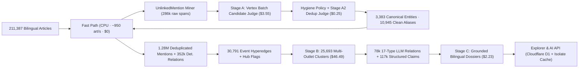

# Building a Bilingual News Knowledge Graph over 211,387 Bangladeshi Articles for $52

*How Jachaikori (যাচাই করি) resolves Bangla & English entities, temporal political offices, 17 directional relationship types, and corpus-cited dossiers — without turning the graph into a hairball or burning through LLM budgets.*

---

## Why Neither Pure Dictionaries Nor Pure LLMs Work at 211k Scale

When we finished crawling and clustering **211,387 articles** across 8 accredited Bangladeshi news outlets (`Prothom Alo`, `The Daily Star`, `The Business Standard`, `bdnews24`, `Daily Ittefaq`, `Jugantor`, `Kaler Kantho`, and `Bangladesh Pratidin`), we had a clean semantic index of `30,973` event clusters — but our v1 entity layer was stuck in prototype territory:

1. **A closed vocabulary of ~188 hand-seeded entities.** Every new minister, governor, university, regulatory body, or public policy program (`Mostakur Rahman`, `Ahsan H Mansur`, `Farmers Card`, `Bangla QR`, `Combined Islamic Bank`) was invisible.
2. **Temporal role mismatches.** In Bangladeshi news, `"প্রধানমন্ত্রী"` (*Prime Minister*) means Sheikh Hasina in 2023, has no incumbent during the 2024–2026 interim government, and means Tarique Rahman from February 17, 2026 onward. Worse, a naive 1-token lookbehind rule misfired **11 times** on our 128-article evaluation set whenever articles mentioned foreign or former prime ministers (`"ভারতের প্রধানমন্ত্রী নরেন্দ্র মোদি"`, `"former Prime Minister Khaleda Zia"`).
3. **Graph hairballs.** Almost every article starts with `"ঢাকা, ১৪ নভেম্বর:"` or mentions `"বাংলাদেশ"` or `"পুলিশ"`. Linking everything naively and emitting `co_occurred` edges turned every entity graph into an unreadable star centered on Dhaka and Bangladesh.
4. **No entity descriptions and only 5 narrow relation types.** Our future **Entity Relationship Explorer** UI — and external AI/RAG agents querying Jachaikori — needed neutral bilingual profiles (*"Who is this entity? What have they done in the corpus?"*) and rich directional relationships beyond political resignations and lawsuits.

Running an LLM over all 211,387 articles one-by-one wasn't the answer either: even with a fast model, per-article extraction creates duplicate spelling IDs (`আনোয়ার হোসেন` vs `আনোয়ার হোসাইন`), hallucinates outdated offices from parametric memory, and doesn't scale cleanly to hourly production ingestion on a $5/month Cloudflare budget.

So we built **Entity Resolution v2**: a hybrid engine that splits the problem into a **zero-cost, sub-millisecond deterministic runtime** and a **4-stage offline Vertex AI Batch pipeline**.

---

## Architecture Overview: Fast Path vs. Slow Path

### 1. The Fast Path: Deterministic Trie Resolver (`packages/entities`, `v2.0.0`)

Every article passes through a pure, zero-I/O resolver compiled from a versioned registry snapshot (`compileRegistry(snapshot)`):

- **Single-pass Bangla/English normalization & dateline stripping:** Before matching a single token, we strip newspaper wire prefixes (`"নিজস্ব প্রতিবেদক, ঢাকা:"`, `"Staff Correspondent, Dhaka:"`, `"ঢাকা, ১৪ নভেম্বর:"`) so routine datelines never emit fake location mentions. We also handle hyphenated Bangla case suffixes (`বিএনপি-র`, `বিজিএমইএ-এর`, `ইউনূস-কে`), orthographic variants (`হোসেন`/`হোসাইন`, `নিম্নতম`/`ন্যূনতম`), and stem-matching on **every token position** of multi-word aliases.
- **Temporal `role_term` windows:** Bare office titles (`প্রধানমন্ত্রী`, `Prime Minister`, `প্রধান উপদেষ্টা`, `Chief Adviser`) do not point directly to a person. They point to a `role` entity (`ent_role_prime_minister`), which looks up the active holder in `role_term(role_entity_id, holder_entity_id, valid_from, valid_to)` using the article's publication date.
- **Multi-token role guards + apposition lookahead:** Before binding `"প্রধানমন্ত্রী"` to the incumbent Bangladeshi PM, the resolver checks:
  1. **Lookbehind qualifiers (1–3 tokens):** Explicit former/foreign qualifiers (`সাবেক`, `ভারতের`, `পাকিস্তানের`, `former`, `Indian`) block binding to the incumbent.
  2. **Apposition lookahead:** If a person name immediately follows (`"প্রধানমন্ত্রী নরেন্দ্র মোদি"`), bind to that person (or emit an `UnlinkedMention`), never to Bangladesh's PM.
  3. **Headline-topic guard:** If the headline explicitly names a former or foreign leader, bare `"PM"` references inside the body are suppressed from binding to the incumbent.
- **Deduplicated mentions with separate link confidence & salience:** Each `(article_id, entity_id)` is stored once with `mention_count`, `in_headline`, `link_method` (`name_exact`, `alias_stem`, `role_dated`, `role_inferred`, `article_coref`), `link_confidence`, and `salience`.
- **Throughput:** Streams all `211,387` articles on local CPU at **~950 articles/second**, and resolves ad-hoc API requests (`POST /resolve`) in **2.7 ms**.

### 2. The Slow Path: 4-Stage Vertex AI Batch Pipeline (`$52.56` Total)

Rather than sending 211k full articles to an LLM, we used **Vertex AI Batch Prediction** (`gemini-3.5-flash` on `global`, `thinkingBudget: 0`, 50% async batch discount, strict JSON `responseSchema`) only where semantic judgment genuinely pays off:

| Stage | Scope | Requests | Result | Actual Cost |
| :--- | :--- | ---: | :--- | ---: |
| **Stage A — Long-Tail Discovery** | Recurring unlinked proper-noun spans (`>= 6` articles, `>= 2` outlets) mined across all 211k articles, grouped 25/prompt | `588` | `3,418` promoted entities, `3,187` exact merges, `5,342` denylisted | **`$3.55`** |
| **Stage A2 — Duplicate Merge Judge** | Same-type entity pairs sharing `>= 3` events & lexical trigram similarity `>= 0.45` (`816` pairs) | `41` | `99` auditable, reversible merges in `entity_merge_log` | **`$0.25`** |
| **Stage B — Multi-Outlet Relations & Claims** | 1–2 richest representative articles (longest Bangla + longest English) per multi-outlet event cluster (`25,693` clusters) | `33,220` | `78,285` directional 17-type LLM relations + `116,960` structured claims (`69,960` with numbers, `50,602` with dates) | **`$46.49`** |
| **Stage C — Grounded Bilingual Dossiers** | All `96` seed entities + every active entity with `>= 5` articles or `>= 2` events (`3,328` entities) fed their real `role_term`s, top relations, and top 8 salient articles | `3,328` | `3,328 / 3,328` neutral bilingual taglines & bios with `3,318` citing corpus article IDs | **`$2.23`** |
| **Smoke Tests** | Pre-flight 3-item schema checks | `6` | Verified end-to-end before batch submission | **`$0.04`** |
| **Total** | **Full 211,387-Article Knowledge Graph** | **`37,183`** | **3,383 entities · 430k relations · 117k claims** | **`$52.56`** |

### 3. Two-Level Relationships: 17 Canonical Types + Specific Predicate Labels

Five political relation types weren't enough to describe central bank directives, bilateral loans, family/party affiliations, or regulatory rulings. We moved to a **two-level schema**:

1. **17 canonical `relation_type` values** (for graph coloring, SQL filtering, and aggregation):
   - *Structure & Career:* `holds_role`, `affiliated_with`, `part_of`, `appointed_or_elected`, `resigned_or_removed`
   - *Speech & Stance:* `quoted_about`, `supported_or_endorsed`, `criticized_or_opposed`, `demanded_or_urged`
   - *Economy, Policy & Governance:* `signed_deal_or_agreed`, `funded_or_invested`, `regulated_or_directed`
   - *Law & Accountability:* `investigated_or_charged`, `ruled_or_sentenced`
   - *Diplomacy & Specific Incidents:* `met_with`, `diplomatic_action`, `incident_at`
2. **Concise free-text `predicate_label`** on every LLM edge alongside its verbatim Bangla/English `evidence_snippet`. For example, querying `GET /entities/ent_bangladesh_bank/relations` returns:
   - `Arif Hossain Khan --[holds_role: "executive director and spokesperson of"]--> Bangladesh Bank` (`103` articles)
   - `Mostakur Rahman --[holds_role: "current governor of"]--> Bangladesh Bank` (`87` articles)
   - `Ahsan H Mansur --[holds_role: "former governor of"]--> Bangladesh Bank` (`58` articles)
   - `Bangladesh Bank --[regulated_or_directed: "made mandatory for retail merchants"]--> Bangla QR` (`24` articles)
   - `Bangladesh Bank --[regulated_or_directed: "dissolved the board of"]--> Islami Bank Bangladesh PLC` (`22` articles)
   - `Criminal Investigation Department --[investigated_or_charged: "investigating the reserve theft case"]--> Bangladesh Bank` (`16` articles)

We completely eliminated `co_occurred` and generic `located_in` rows from `entity_relation`; event-level co-occurrence lives cleanly in `event_entity` ranked by **damped PMI** (`log(1 + together) * PMI`).

### 4. Why We Kept `Bangladesh` Instead of Deleting It

Early on we asked whether we should delete `Bangladesh` as an entity since almost all our articles come from Bangladesh. We kept it — and instead implemented **Hub Demotion (`is_hub = 1`)**:

- Deleting `ent_bangladesh` would erase genuinely valuable macro facts (`"Bangladesh Bank --(part_of: central bank of)--> Bangladesh"`, `"Fitch cuts Bangladesh outlook"`, `"Tarique Rahman --(holds_role: prime minister of)--> Bangladesh"`) and break `বাংলাদেশ` ↔ `Bangladesh` cross-lingual query expansion during fact-checking.
- Instead, we explicitly mark `ent_bangladesh`, `ent_dhaka`, and `ent_police` as hubs and dynamically flag any entity appearing in `> 15%` of all events (which automatically caught `ent_parliament` and `ent_bnp` too — `5` hubs total).
- Hub entities stay searchable, directly inspectable via `/entities/:id`, and visible in explicit macro/structural relations (`holds_role`, `part_of`, `diplomatic_action`, `funded_or_invested`, `signed_deal_or_agreed`, `regulated_or_directed`), while default neighbor graphs (`/entities/:id/ego`) filter out hubs *before* ranking the top 20 neighbors. The result: `ent_tareque_rahman/ego` returns `Atiqur Rahman Rumon`, `Mahdi Amin`, `Khaleda Zia`, `Rashed Al Mahmud Titumir`, `Farmers Card`, and `Zahed Ur Rahman` — **zero** `Dhaka`/`Bangladesh`/`Police` clutter.

---

## Five Real-World Bugs We Caught & Fixed Along the Way

Building on 211,387 real Bangla/English articles exposed subtle failures that unit tests alone never catch:

1. **Bangla SOV Word Order Broke Our Foreign-PM Guard.**
   In Bengali (Subject–Object–Verb), `"আজ তুরস্ক যাচ্ছেন প্রধানমন্ত্রী"` (*"Today to Turkey is going the Prime Minister"*) puts `"তুরস্ক"` (*Turkey*) two tokens before `"প্রধানমন্ত্রী"`. Our first stemmed lookbehind treated `"তুরস্ক"` as a foreign qualifier and refused to link Bangladesh's PM! **Fix:** Restrict foreign-country lookbehind to explicit possessive/adjectival forms (`তুরস্কের`, `ভারতের`, `Indian`) on raw tokens and require immediate adjacency (`gap === 1`) for location spans.
2. **The `বেলা` ("o'clock" vs. BELA) Homograph Disaster.**
   During Stage A, Gemini rightly recognized the Bangladesh Environmental Lawyers Association (`BELA`) and added its Bangla acronym `"বেলা"` as an alias. In Bangla news, `"বেলা ১১টায়"` (*"at 11 AM"*) appears constantly — instantly giving BELA **10,803 false article mentions**! **Fix:** Added a strict `isSafeAutoAlias()` hygiene gate blocking Bangla homograph acronyms (`বেলা`, `বিনা`, `নগদ`, `ইউপি`), generic administrative nouns, single-token person aliases, and enforcing `requireUppercase` on short ASCII acronyms — blocking `324` hazardous aliases and re-ingesting from our cached Stage A JSONL in `1.75s` for `$0`.
3. **Cross-Type Token-Subset Merging Ate `Ziaur Rahman`.**
   Our first promotion heuristic checked whether a candidate's tokens were a subset of an existing entity. Because `"শহীদ জিয়াউর রহমান মেডিকেল কলেজ হাসপাতাল"` (`org`) was processed before `"জিয়াউর রহমান"` (`person`), the former President merged into a hospital! **Fix:** Removed cross-type subset merging entirely, sorted verdicts by `doc_freq DESC`, and restricted automatic merging to same-type canonicals + the conservative Stage A2 judge.
4. **Partial Substring Matching on LLM Relation Endpoints.**
   When resolving Gemini's Stage B relation names back to canonical IDs, an unguarded fallback resolver could map an unknown `"Dhaka WASA"` onto `ent_dhaka`. **Fix:** Require high surface-length coverage (`>= 85%` for hubs/locations, `>= 60%` for non-hubs) after checking exact/parenthetical/title-stripped aliases.
5. **The 42-Second SQLite Cartesian Join Trap.**
   Benchmarking our live Worker API directly against the 211k SQLite file caught two dramatic latency regressions:
   - `GET /entities/suggest` took **`2,651 ms`** because `entity_alias` lacked an index on `entity_id` (forcing a 37M-row nested scan). Adding `idx_alias_entity` and switching `LEFT JOIN` + `DISTINCT` to `EXISTS` dropped it to **`13.1 ms`** (**202× faster**).
   - `GET /entities/ent_tareque_rahman/ego` took **`42,402 ms`** because `JOIN entity eb` caused SQLite's planner to build a Cartesian product between `3,378` active entities and `4,519` events (**15.2 million probes!**). Locking join order with `CROSS JOIN` (`a -> b -> eb`) cut it to **`193.4 ms`** (**219× faster**).

---

## Before & After Metrics

### Golden Evaluation Set (`eval_128.jsonl`)

| Metric | Sprint 4 (v1) | Sprint 5 (v2) | Change |
| :--- | ---: | ---: | :--- |
| Flagged PM false positives | `11` | **`0`** | **-100%** |
| Article-entity mention rows | `811` | **`501`** | **-38.2% bloat** (deduplicated) |
| Deterministic relation rows | `529` | **`160`** | **-69.8% noise** (dropped `co_occurred` / generic `located_in`) |

### Production 211k Knowledge Graph (`data/index/index.sqlite`)

| Metric | Value |
| :--- | ---: |
| Articles resolved | **`211,387`** (`1,285,082` deduplicated mentions) |
| Active canonical entities | **`3,383`** (`96` curated seed + `3,287` verified auto; `99` auditable merges; `5,341` denylisted) |
| Clean aliases | **`10,945`** (`324` unsafe homographs/generics blocked) |
| Entities with bilingual corpus-grounded dossiers | **`3,383 / 3,383`** (`3,318` with direct article citations) |
| Event-entity hyperedges (`event_entity`) | **`240,219`** rows across **`30,791`** clusters (`5` hubs flagged) |
| Directional 17-type relationships (`entity_relation`) | **`430,231`** (`351,946` deterministic + `78,285` LLM-extracted across all 17 types) |
| Structured verifiable claims (`claim`) | **`116,960`** (`69,960` with numbers · `50,602` with dates · `32,689` with canonical speakers) |
| Live API latency (211k SQLite) | `/entities` **1.1 ms** · `/entities/:id` **4.4 ms** · `/suggest` **13.1 ms** · `/ego` **109–193 ms** · `POST /resolve` **2.7 ms** |

---

## Honest Limitations & What's Next

No entity engine is magic, and two limitations are worth naming plainly:

- **Homonymous Bangla person names:** Common two-word Bangladeshi names (`নজরুল ইসলাম`, `রফিকুল ইসলাম`, `শফিকুল ইসলাম`, `সাইফুল ইসলাম`, `মিজানুর রহমান`) genuinely belong to multiple real people across different beats — a police sub-inspector, a university professor, and a local politician can share the exact same full name. Any dictionary/alias linker merges them under one canonical ID unless paired with context-aware entity disambiguation (NED) using surrounding role/organization vectors. We plan to address high-ambiguity personal names with a cluster-context disambiguator in a future pass.
- **Role transitions require updating `registry/seed.yaml`:** Because `role_term` windows are explicit data (`valid_from` / `valid_to`) rather than hardcoded logic, future cabinet or government transitions only require adding one YAML row and running `sync-seed` — no code deploy needed.

With the 211k Knowledge Graph, 17-type relationships, 116k structured claims, and 3,383 bilingual dossiers now live behind `/entities/:id`, `/entities/:id/articles`, `/entities/:id/relations`, `/entities/:id/ego`, and `POST /resolve`, we have the exact factual backbone needed for **Sprint 6 (Dual-Provider Photo-Card VLM Verification)** and **Sprint 7 (Claim-Level Diff Engine & Entity Relationship Explorer UI)**.
