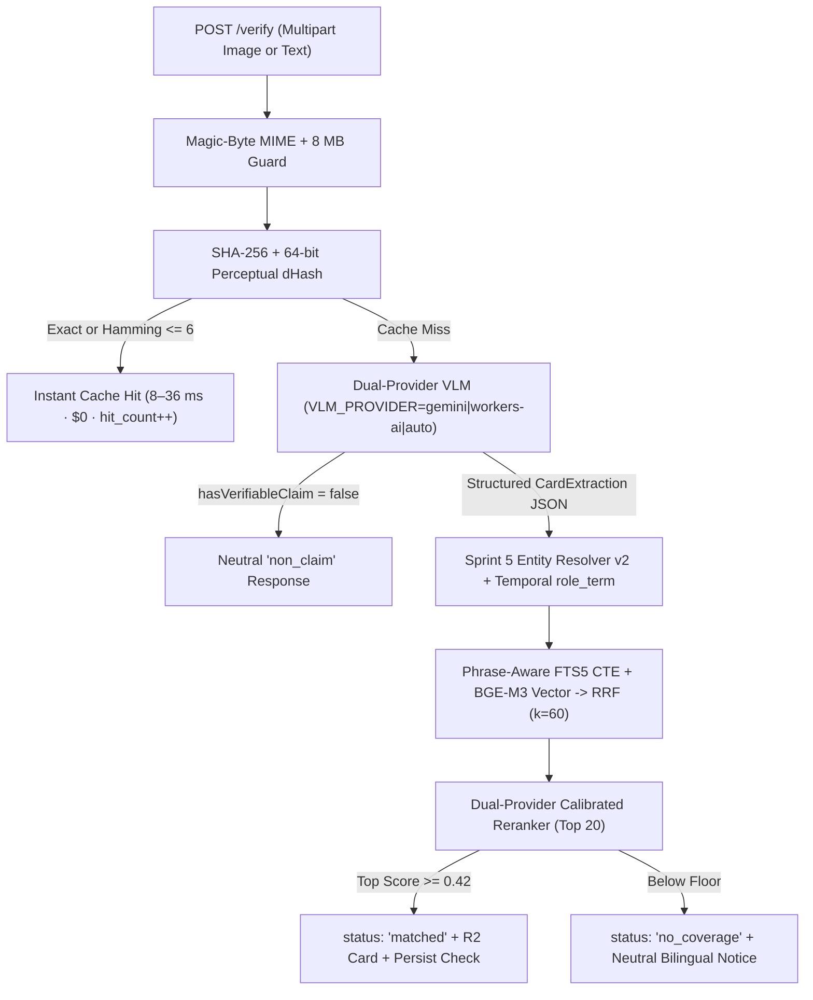

# Zero-Dependency Perceptual Hashing, Dual-Provider VLMs, and 84ms Bangla Retrieval over 211k Articles

*How Jachaikori (যাচাই করি) verifies viral Bangladeshi photo cards end-to-end inside Cloudflare Workers — catching recompressed Facebook reposts for $0, staying provider-agnostic across Gemini & Cloudflare Workers AI, and refusing to call any claim "true" or "fake."*

---

## The Problem: Viral Photo Cards Don't Behave Like Clean Search Queries

Bangladeshi social media runs on **news photo cards**: a photo, a stylized Bangla headline or pull-quote (`"..." — অমুক`), and an outlet logo stamped in the corner. Many pages repost legitimate cards with no link back to the original reporting — and some quietly edit a figure, shift a date, or misattribute a quote.

Turning a phone screenshot of a viral photo card into ranked accredited coverage sounds straightforward until you hit four real-world constraints:

1. **Same card, different bytes.** Every time Facebook or WhatsApp re-saves a viral card, JPEG recompression changes its SHA-256 hash completely. Without perceptual deduplication, a single viral card checked by 500 readers triggers 500 redundant VLM calls.
2. **Cloudflare Workers has no native C++ image libraries.** You cannot `npm install sharp` or `canvas` inside a Cloudflare Worker isolate. Any perceptual hash has to be pure Web-Standard TypeScript.
3. **Provider lock-in kills budget ceilings.** We want Gemini Flash's superior Bangla stylized-font OCR while our GCP free credits last, *and* a one-line switch (`VLM_PROVIDER=workers-ai`) to Cloudflare Workers AI (`env.AI` + `@cf/baai/bge-reranker-base`) so post-credit hosting stays under **$5/month**.
4. **Honesty over false confidence.** A verification tool must never declare a claim *"true"* or *"fake"*, and must never hallucinate a weak match just to return *something*. When none of the 8 indexed outlets covered a claim, it has to say so clearly and neutrally.

Sprint 6 solves all four inside a pure Web-Standard package (`@jachaikori/verification`) wired straight into `apps/api`.

---

## Architecture: End-to-End Online Verification Path

### 1. Pure-TypeScript Perceptual `dHash` Without Native Dependencies

To catch recompressed viral reposts inside Cloudflare Workers with zero native libraries, we built a 64-bit **Difference Hash (`dHash`)** engine in [image-hash.ts](file:///home/bast0k/projects/jachaikori/packages/verification/src/image-hash.ts):

- **Magic-byte validation first:** Never trust a client `Content-Type` header. We inspect the raw header bytes (`FF D8 FF` for JPEG, `89 50 4E 47` for PNG, `RIFF....WEBP` for WebP) and enforce an **8 MB** limit before buffering.
- **PNG path:** Unpacks `IHDR`/`IDAT` chunks using the built-in Web Standard `DecompressionStream('deflate')`, reconstructs PNG scanline filters (`Sub`/`Up`/`Average`/`Paeth`), downsamples to `9×8` luminance, and compares horizontal neighbors into 64 bits.
- **Baseline JPEG DC-luminance trick:** A full JPEG decoder in JS is heavy, *but a `9×8` thumbnail doesn't need high-frequency AC pixels!* Every baseline JPEG encodes each `8×8` luminance block with **one DC coefficient** representing the exact average brightness of that block. By decoding *only* the Y-channel DC coefficients from the Huffman entropy stream and skipping the 63 AC coefficients, we extract an exact luminance grid in a couple of milliseconds.
- **Real-world proof:** We generated an 800×460 news photo card at **JPEG quality 92 (`54.4 KB`)** and recompressed it to **JPEG quality 60 (`29.7 KB`)** — nearly half the file size, completely different SHA-256 hash. Both produced the exact same 64-bit `dHash` (`a000d4c8a0d08000`, **0-bit Hamming distance**), turning the repost check into a **`36 ms` / `$0`** perceptual cache hit!

### 2. Dual-Provider VLM & Reranker (`VLM_PROVIDER=gemini | workers-ai | auto`)

Every external model call sits behind two minimal interfaces (`VlmExtractor` and `CandidateReranker`) with a deterministic SQLite/D1 response cache (`vlm_cache` keyed by `sha256(inputHash | promptVersion | modelId)`):

- **`GeminiFlashAdapter`** ([gemini.ts](file:///home/bast0k/projects/jachaikori/packages/verification/src/providers/gemini.ts)): Talks directly to GCP Vertex AI REST (`gemini-3.5-flash` @ `global`) or Google AI Studio (`GEMINI_API_KEY`) using strict JSON `responseSchema`. Handles OCR, structured Bangla/English claim extraction, publisher logo normalization (`প্রথম আলো` → `prothom-alo`, `TBS` → `business-standard`), and calibrated listwise reranking.
- **`WorkersAiAdapter`** ([workers-ai.ts](file:///home/bast0k/projects/jachaikori/packages/verification/src/providers/workers-ai.ts)): Calls Cloudflare's native `env.AI` binding inside Workers (or Cloudflare REST API locally) for multimodal extraction (`@cf/meta/llama-3.2-11b-vision-instruct`) and native cross-encoder reranking (`@cf/baai/bge-reranker-base`, with LLM listwise fallback).
- **`HeuristicVerificationAdapter`** ([heuristic.ts](file:///home/bast0k/projects/jachaikori/packages/verification/src/providers/heuristic.ts)): Zero-LLM deterministic extractor and lexical/entity overlap reranker for offline tests and text-only fallback.
- **Automatic failover (`factory.ts`):** When `VLM_PROVIDER=auto`, requests prefer Gemini while GCP credits remain and automatically fall back to Workers AI if Gemini returns a quota/auth error.

### 3. Entity-Aware Query Building Powered by Sprint 5

Raw OCR text from a Bangla card rarely matches English reporting (`"বাংলাদেশ ব্যাংক বিডা-নিবন্ধিত..."` vs `"BB eases foreign borrowing rules for BIDA-registered firms"`), and bare titles like `"প্রধানমন্ত্রী"` depend on the card's date.

Our query builder ([query-builder.ts](file:///home/bast0k/projects/jachaikori/packages/verification/src/query-builder.ts)) pipes the extracted headline, speaker, and claimed date straight into Sprint 5's compiled resolver (`resolveArticle`, `~19 ms`) and `AliasDictionaryExpander`:
- Resolves `"প্রধানমন্ত্রী"` on a 2026 card to `ent_tareque_rahman` (`Tarique Rahman` / `তারেক রহমান`), and `"বাংলাদেশ ব্যাংক"` + `"বিডা"` to `ent_bangladesh_bank` + `BIDA`.
- Keeps multi-word canonical entity names as intact FTS5 phrases (`"বাংলাদেশ ব্যাংক"`) while expanding cross-lingual Bangla ↔ English aliases and preserving exact numeric tokens.
- Fuses keyword FTS5 and semantic BGE-M3 candidates with **Reciprocal Rank Fusion (`k = 60`)**, then passes the top 20 unique articles to the calibrated reranker with a **`0.42` confidence floor**.

---

## Two Real-World Bugs We Caught Live on the 211k Corpus

Mocked unit tests passed on the first run — and then live testing against our **211,387-article / 422,838-chunk** database immediately caught two real production traps:

1. **The Broad Bangla FTS5 `OR` Full-Table Join Trap.**
   Our original `runKeywordSearch()` joined `chunk_fts` to `chunk`, `article`, `article_cluster`, and `event_cluster` *before* sorting by `bm25(chunk_fts) LIMIT 30`. When an expanded Bangla `OR` query included a frequent token like `"বাংলাদেশ"`, SQLite joined **150,000+ rows** across a 2.5 GB database just to keep 30 — stalling for minutes!
   **Fix:** Wrap the FTS5 lookup in a top-BM25 CTE (`WITH hits AS (SELECT rowid, bm25(chunk_fts) as rank FROM chunk_fts WHERE chunk_fts MATCH ? ORDER BY rank ASC LIMIT ?)`) so table joins execute on at most 30–200 rowids, and keep multi-word canonical entities as quoted FTS5 phrases instead of splitting `"বাংলাদেশ ব্যাংক"` into `"বাংলাদেশ" OR "ব্যাংক"`. Result: **retrieval across 422,838 chunks dropped to `84 ms`**.
2. **Gemini 3.x Multimodal `thinkingConfig` Gotcha.**
   `gemini-3.5-flash` accepted `thinkingConfig: { thinkingBudget: 0 }` on text-only prompts, so text verification passed right away — until our first live JPEG photo-card upload failed with `HTTP 400: "Thinking budget is not supported for this model."` Removing `thinkingConfig` altogether then caused Gemini 3.5 Flash to default to deep reasoning and hit our 30-second timeout!
   **Fix:** Gemini 3.x uses **`thinkingConfig: { thinkingLevel: 'MINIMAL' }`** instead of Gemini 2.5's `thinkingBudget: 0`. Gating `thinkingLevel: 'MINIMAL'` to Gemini 3.x and `thinkingBudget: 0` to Gemini 2.5 (with automatic 400 retry fallback) brought live multimodal JPEG OCR + extraction down to ~4 seconds cleanly.

---

## Live 211k Verification Benchmarks (`scripts/probe-vlm.ts`)

| Test Scenario (Live 211,387-Article SQLite DB) | Status | Cache Hit | Retrieval | Total Latency | Cost (USD) | Top Accredited Match |
| :--- | :--- | :--- | ---: | ---: | ---: | :--- |
| **JPEG Photo Card (54.4 KB, Q=92)** | `matched` | `none` | `~90 ms` | `8,293 ms` | `$0.0058` | `[0.95]` *The Daily Star* — "BB eases foreign borrowing rules for BIDA-registered firms" |
| **Recompressed Repost (29.7 KB, Q=60)** | `matched` | **`perceptual`** (`dHash` dist `0`) | `0 ms` | **`36 ms`** | **`$0.0000`** | Instant cached check (`hitCount: 2`) |
| **Bangla Claim Text** | `matched` | `none` | **`84 ms`** | `10,098 ms` | `$0.0056` | `[0.95]` *Prothom Alo* + `[0.92]` *Kaler Kantho* |
| **Repeat Bangla Claim** | `matched` | **`exact`** | `0 ms` | **`8 ms`** | **`$0.0000`** | Instant cached check (`hitCount: 2`) |
| **Fictional Claim (Mars bullet train)** | **`no_coverage`** | `none` | `< 80 ms` | `~3,000 ms` | `$0.0012` | `0` sources + neutral bilingual empty-state notice |

All checks persist to `verification_check` (`0005_checks.sql`), store uploaded cards in R2 (`CARDS_BUCKET` / local disk), and power shareable `GET /checks/:id`, immutable `GET /checks/:id/image`, and anonymous `GET /checks/popular`.

---

## What's Next: Sprint 7 (Claim-Level Diff Engine & Frontend Handoff)

Right now `POST /verify` tells you *which* accredited articles covered a card's story. In **Sprint 7**, we'll plug in the **Claim-Level Diff & Distortion Engine** — comparing the card's extracted numbers (`৫০০ কোটি` vs `৫০ কোটি`), dates, quoted speakers, and hedging strength (`"may"` / `"সম্ভাব্য"` vs `"will"` / `"নিশ্চিত"`) directly against our 116,960 pre-extracted Stage B claims and Sprint 5's `role_term` graph — and then hand off the finalized API contract + design context brief to build the brand-new frontend.
