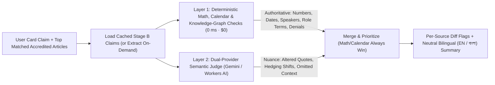

# What Are "Claims", and How Does Jachaikori's Diff Engine Catch Altered Photo Cards?

*A plain-English guide to how Jachaikori breaks news articles down into checkable facts, spots altered numbers, recycled dates, and stripped context on viral Bangladeshi photo cards — and compares how different news outlets cover the exact same story.*

---

## First: What Actually Is a "Claim"?

A full news article is usually 300 to 800 words of background, scene-setting, and commentary. If you try to compare a 15-word Facebook photo card against five 600-word articles directly, it is messy, slow, and easy for an AI to get distracted by irrelevant paragraphs.

So Jachaikori turns long articles into bite-sized, structured **claims**.

Think of a **claim** as a single, self-contained factual statement or quote pulled out of an article and filed in a tidy structured card:

- **What was said (`claimText`):** e.g., *"Bangladesh Bank relaxed foreign borrowing rules for BIDA-registered companies"* or *"PM handed over a Tk 3 crore grant cheque for Christmas celebrations."*
- **Who said it (`speakerEntityId` / `speakerName`):** Linked to our canonical entity registry (so `"প্রধানমন্ত্রী"` on a 2026 article links to `Tarique Rahman`, not a generic string).
- **Exact numbers (`numbers`):** Every figure preserved verbatim with its unit (e.g., `["৩ কোটি টাকা"]`, `["$4.7B"]`, `["১২%"]`).
- **Exact dates (`dates`):** Every date or time reference mentioned in that claim (`["18 November 2026"]`, `["গতকাল"]`).
- **How certain the journalist was (`hedgingLevel`):** One of four levels:
  - `certain` — reported as a confirmed fact (*"The board approved Tk 3 crore"*)
  - `reported` — attributed to a source or official (*"BNP said the reports are false"*)
  - `hedged` — cautious or speculative (*"may", "likely", "সম্ভাব্য", "গুঞ্জন"*)
  - `conditional` — depends on an "if" (*"if approved by the cabinet..."*)
- **Receipt (`evidenceSnippet`):** The exact verbatim sentence from the original article that backs up this claim.

Back in Sprint 5, we already extracted **116,960 structured claims** across our multi-outlet event clusters (`69,960` of them carrying exact numbers, `50,602` carrying dates, and `32,689` linked to canonical speakers). When a user checks a photo card today, Jachaikori usually doesn't even have to re-read the whole news article — it pulls those pre-extracted claims straight out of the database in milliseconds! And if a matched article happens not to have claims extracted yet, the engine extracts them on the spot and saves them to the database so the next check is instant and free.

---

## Why Finding Matching Articles Isn't Enough

After Sprint 6, Jachaikori could already take a photo card and find the real news articles about the same story.

But viral misinformation in Bangladesh is often **90% real and 10% edited**:
- A real *Ittefaq* story says the Prime Minister handed over a **Tk 3 crore** grant — a viral repost quietly edits the card to say **Tk 30 crore**.
- A real *Jugantor* headline says **"Rumors of more BNP leaders resigning are baseless (`গুজব`)"** — a viral card drops the word `"গুজব"` and claims **"Multiple senior BNP leaders confirmed to have resigned."**
- A real quote from **2024** gets slapped onto a fresh card stamped with **today's date** to look like breaking news.
- A real quote from one politician gets pasted under a different leader's photo.

If our tool only showed *"Here is a matching article"*, a busy reader scrolling on their phone might glance at the headline and assume the card was accurate. **The Diff Engine's job is to do the tedious side-by-side checking automatically — and highlight the exact spot where the card and the accredited reporting diverge.**

Importantly, Jachaikori **never stamps a card "TRUE" or "FAKE."** It simply shows neutral, cited receipts: *"The card says X; the accredited report from Prothom Alo says Y."*

---

## How the Diff Engine Works (Plain English, Step by Step)

LLMs are great at understanding nuance, sarcasm, and missing context — and notoriously bad at South Asian math (converting `৫০০ কোটি টাকা` into `Tk 5 billion`) or calendar arithmetic. So we split the Diff Engine into **two layers that work together**:

### Layer 1: Deterministic Rules (Fast, Exact, Zero Hallucination)

Before an LLM even looks at the comparison, four pure TypeScript checks run in a few milliseconds:

1. **The Bangla/English Number Normalizer (`numbers.ts`):**
   Converts Bangla digits (`০-৯`) to ASCII (`0-9`) and translates both South Asian scales (`হাজার`, `লাখ`, `কোটি`) and international scales (`thousand`, `million`, `billion`) into one common numeric value and unit family (`BDT`, `USD`, `%`, or count):
   - `"৫০০ কোটি টাকা"` and `"Tk 5 billion"` both normalize to `5,000,000,000 BDT` → **`match`** (even across two different languages and numbering systems!).
   - `"$4.7B"` vs `"$4.72 billion"` is within a 2% rounding window → **`match`** (no false alarms over press rounding).
   - `"৩০ কোটি টাকা"` vs `"৩ কোটি টাকা"` is a 10× difference → authoritatively flagged as **`mismatch_number` (`major`)**.
   - Calendar dates (`"১৮ নভেম্বর ২০২৬"`) and bare years (`"2026"`) are stripped out first so the day `"18"` is never accidentally compared as a quantity.

2. **The Bangla/English Calendar Checker (`dates.ts`):**
   Understands both English (`18 Nov 2026`) and Bangla (`১৮ নভেম্বর ২০২৬`) dates, plus relative words like `"গতকাল"` (*yesterday*) or `"আগামীকাল"` (*tomorrow*) resolved against the article's publication timestamp in Bangladesh time (`Asia/Dhaka`, UTC+6).
   - Same day (±1 day for late-night print/online publishing) → **`match`**.
   - Off by 2–29 days → **`mismatch_date` (`notable`)**.
   - Off by 30+ days (or a card using `"এইমাত্র"` / `"Breaking"` framing on an article from 6+ months ago) → **`mismatch_date` (`major`)**, clearly telling the reader when the original story was actually published.

3. **The Speaker & Office-Tenure Checker (`speaker.ts`):**
   Uses Sprint 5's Knowledge Graph to check two things:
   - **Wrong speaker (`mismatch_speaker`):** If the card puts a quote in Leader A's mouth, while the accredited article's claims attribute quotes to Leader B, it flags the attribution difference.
   - **Outdated title (`missing_context`):** If a 2026 card refers to someone as `"প্রধানমন্ত্রী"` (*Prime Minister*) without `"সাবেক"` (*former*), and our `role_term` timeline shows their term ended in 2024, it surfaces a neutral office-tenure note.

4. **The Denial & Hedging Guard (`heuristic.ts`):**
   Instantly catches two of the most common Bangladeshi social-media tricks:
   - **Stripped denials (`missing_context`):** If the accredited article explicitly contains words like `"গুজব"` (*rumor*), `"ভিত্তিহীন"` (*baseless*), `"অস্বীকার"` (*denied*), or `"baseless"` — and the viral card omits them completely — it raises a `major` flag immediately.
   - **Certainty inflation (`hedging_shift`):** If the accredited report says `"সম্ভাব্য"` / `"may"` / `"reportedly"` (`hedged` or `conditional`), while the card states it as an accomplished fact, it flags the framing shift.

### Layer 2: Dual-Provider Semantic Judge (`GeminiFlashAdapter` / `WorkersAiAdapter`)

Next, our dual-provider LLM judge (the same swappable Gemini / Workers AI setup from Sprint 6, backed by `vlm_cache`) reads the card alongside the article's structured claims to catch subtler distortions that no rule can spot:
- **`mismatch_quote`:** Twisted or exaggerated quote wording.
- **`missing_context`:** e.g., when a card claims *"Multiple senior BNP leaders confirmed to have resigned"* while the real article only reports *a single upazila president stepping down to focus on his ministerial role*.
- Neutral one-sentence summaries in both **English and Bangla** (`diffSummary: { en, bn }`).

Finally, both layers merge with one strict rule: **an LLM can never override a deterministic math, date, or speaker mismatch.** If the numbers don't match, `mismatch_number` stays front and center.

---

## Bonus: Event Coverage Comparison (`GET /events/:id/comparison`)

Because we already have `30,791` event clusters and `116,960` structured claims, we also plugged the same deterministic comparators into a new **Event Coverage Comparison** endpoint. For any multi-outlet news story, it computes in **~5 milliseconds**:

1. **Who published first** — sorting all articles by true UTC timestamp (fixing mixed `+00:00` and `+06:00` outlet feeds) and showing each outlet's lag in minutes (`+0m`, `+90m`, `+211m`).
2. **8-outlet coverage matrix** — which accredited outlets covered the story and which didn't.
3. **Cross-outlet claim alignment vs. differences** — e.g., on our live export-earnings event cluster (`clu_f3f4d047ad0c`), it immediately spotted that 4 outlets agreed on `26%` and 2 outlets agreed on `$35B`, while flagging that headlines mixed `26%` (monthly June growth) against `13%` (annual shortfall from target).

---

## Live 211k Reality Check (`scripts/probe-diff.ts`)

Testing deliberately distorted Bangla cards directly against our 211,387-article database + Vertex AI `gemini-3.5-flash`:

- **10× Number Edit (`"৩০ কোটি টাকা"` instead of `"৩ কোটি টাকা"` on the Christmas grant):** Matched *Bangladesh Pratidin* & *Ittefaq* (`0.85`), reused their Stage B claims, and deterministically flagged **`mismatch_number`** (`"Card states '৩০ কোটি টাকা' (Tk 30 crore), whereas the accredited article reports '৩ কোটি টাকা' (Tk 3 crore)"`) — total cost `$0.0108`.
- **Exaggerated + Recycled Resignation Card (`"বিএনপির একাধিক সিনিয়র নেতার পদত্যাগ নিশ্চিত হয়েছে — ১৮ নভেম্বর ২০২৬"`):** Deterministically flagged **`mismatch_date`** (`240 days apart` from the March 2026 articles) **and** semantically flagged **`missing_context`** (*Kaler Kantho* & *Jugantor* reported only one local upazila leader stepping down, not multiple senior leaders) — total cost `$0.0124`.

We also caught one classic fact-checking trap during live testing: our reranker initially down-scored accredited *debunk* articles (`"পদত্যাগের খবর 'গুজব'"`) because their wording contradicted the viral card! Updating our reranker calibration (`rerank-v1.1.0`) to explicitly treat official denials and rumor clarifications as top relevance matches (`0.85–1.00`) solved it cleanly.

---

## What's Next

All backend verification, claim-diff, entity knowledge graph, and event-comparison endpoints are now locked and tested (**88/88 tests**, 0 TypeScript errors). Next, we'll package the complete API specification, real live JSON fixtures, and your UI/UX vision into `docs/FRONTEND_DESIGN_BRIEF.md` so the redesigned frontend can be built cleanly in parallel with Sprint 8's Cloudflare production deployment.
